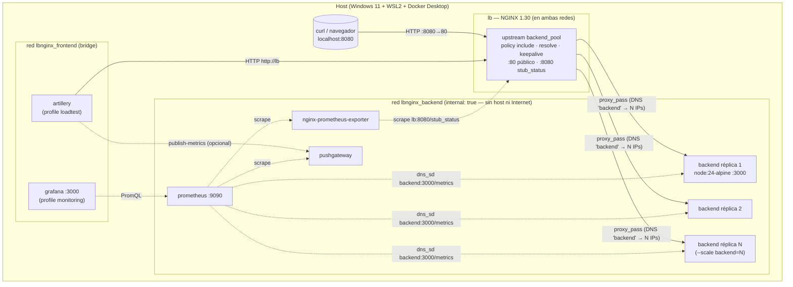
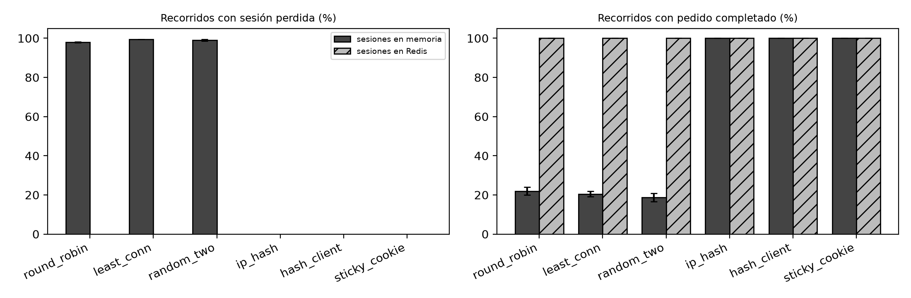
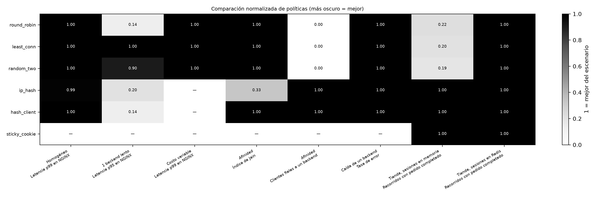
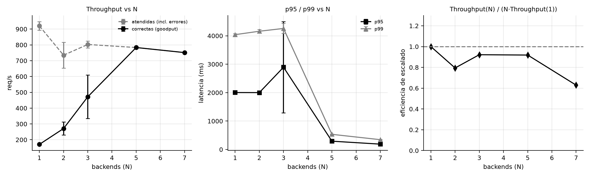
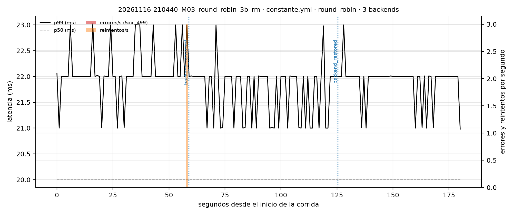

# Balanceador de carga web con NGINX

**Servicios Telemáticos 2026-02 · Proyecto final 2 · Grupo 3 (Lista 1)**
Integrantes: Fabio Jordan C. · Juan David Morales

Clúster web con balanceo de carga de capa 7 basado en **NGINX** (`upstream`), totalmente
contenedorizado con **Docker Compose**: N backends escalables descubiertos por DNS,
seis políticas de balanceo intercambiables desde `.env`, detección pasiva de fallos con
reintentos, métricas en tiempo real (`stub_status` → Prometheus → Grafana), pruebas de
carga reproducibles con **Artillery** y un contenedor de análisis que convierte cada corrida
en tablas y gráficas. Nada se instala en el host.

> **Novedad:** detrás del balanceador corre **TelemaShop**, una tienda web con catálogo, login, carrito y
> compra sobre **PostgreSQL**, con sesiones en **Redis** o en memoria. Permite probar el balanceo con
> estado real (sesiones, base de datos compartida), no solo con una página estática. Ver
> [`docs/tienda.md`](docs/tienda.md) y la comparación de todas las políticas en
> [`docs/comparacion-algoritmos.md`](docs/comparacion-algoritmos.md).
>
> Especificación completa del proyecto: [`docs/especificacion.pdf`](docs/especificacion.pdf) ·
> Enunciado del curso: [`docs/enunciado/`](docs/enunciado/) ·
> Matrices de decisión: [`docs/decision-matrix.md`](docs/decision-matrix.md) ·
> Plan de pruebas: [`docs/plan-pruebas.md`](docs/plan-pruebas.md)

---

## Contenido

1. [Arquitectura](#1-arquitectura)
2. [Requisitos previos](#2-requisitos-previos)
3. [Despliegue paso a paso](#3-despliegue-paso-a-paso)
4. [Variables de entorno](#4-variables-de-entorno)
5. [Operación: políticas, escalado, recarga en caliente, monitoreo](#5-operación)
6. [Pruebas de carga y resiliencia](#6-pruebas-de-carga-y-resiliencia)
7. [Análisis de resultados y matrices de decisión](#7-análisis-de-resultados-y-matrices-de-decisión)
8. [Resultados](#8-resultados)
9. [Cumplimiento de requisitos R-01 … R-25](#9-cumplimiento-de-requisitos)
10. [Seguridad y buenas prácticas](#10-seguridad-y-buenas-prácticas)
11. [Solución de problemas](#11-solución-de-problemas)
12. [Versiones, estructura del repositorio y créditos](#12-versiones-estructura-y-créditos)

---

## 1. Arquitectura



Más diagramas (camino de una petición con reintento, flujo de una corrida) en
[`docs/diagramas/arquitectura.md`](docs/diagramas/arquitectura.md).

### Servicios

| Servicio | Imagen | Redes | Puerto en el host | Profile | Función |
|---|---|---|---|---|---|
| `lb` | `nginx:1.30-alpine` | frontend, backend | `LB_PUBLIC_PORT`→80 (`127.0.0.1:LB_STATUS_PORT`→8080 solo con el override) | — | Balanceador L7 y `stub_status` |
| `backend` | build `./backend` (`node:24-alpine`) | backend | **ninguno** | — | App de prueba instrumentada; N réplicas |
| `artillery` | `artilleryio/artillery:2.0.34` | frontend | ninguno | `loadtest` | Generador de carga (`docker compose run`) |
| `nginx-exporter` | `nginx/nginx-prometheus-exporter:1.5.3` | backend | ninguno | `monitoring` | `stub_status` → Prometheus |
| `prometheus` | `prom/prometheus:v3.16.0` | backend, frontend | 9090 | `monitoring` | Series de tiempo |
| `pushgateway` | `prom/pushgateway:v1.11.5` | backend, frontend | ninguno | `monitoring` | Métricas de Artillery |
| `grafana` | `grafana/grafana:12.4.15` | frontend | 3000 | `monitoring` | Dashboard aprovisionado |
| `cadvisor` | `gcr.io/cadvisor/cadvisor:v0.52.1` | backend | ninguno | `cadvisor` | CPU/RAM por contenedor (opcional) |
| `postgres` | `postgres:17-alpine` | backend | **ninguno** | — | Base de datos de la tienda, compartida por todas las réplicas |
| `redis` | `redis:7.4-alpine` | backend | **ninguno** | — | Sesiones compartidas (`SESSION_STORE=redis`) |
| `analysis` | build `./analysis` (`python:3.12-slim`) | ninguna | ninguno | `tools` | Tablas CSV, gráficas PNG, matrices, comparación consolidada |
| `haproxy` | `haproxy:3.2-alpine` | frontend, backend | `HAPROXY_PUBLIC_PORT`, `127.0.0.1:8404` | (compose.haproxy.yml) | Comparativa A-05 |
| `lb2` | `nginx:1.30-alpine` | frontend, backend, ha | ninguno | (compose.ha.yml) | Segundo balanceador (BACKUP) para A-04 |
| `vrrp1` / `vrrp2` | `alpine:3.22` + keepalived | espacio de red de `lb` / `lb2` | ninguno | (compose.ha.yml) | VRRP e IP flotante `172.31.250.100` (A-04) |
| `navegador` | `mcr.microsoft.com/playwright:v1.64.1-noble` | frontend | ninguno | `capturas` (compose.capturas.yml) | Capturas de evidencia: `/nodo`, `stub_status`, Grafana |

### Decisiones de diseño clave

- **Backend escalable con DNS dinámico.** Un solo servicio `backend` con `deploy.replicas` y
  `docker compose up --scale backend=N`. El `upstream` usa `server backend:3000 resolve` +
  `zone` + `resolver 127.0.0.11 valid=5s`: NGINX re-resuelve el nombre cada 5 s y las réplicas
  nuevas reciben tráfico **sin recargar**. (`resolve` está en NGINX OSS desde 1.27.3.)
- **Configuración 100 % externa.** La imagen oficial no se modifica: `nginx.conf`, plantillas,
  políticas, extras y la página de mantenimiento se montan `:ro`. Las plantillas se procesan
  con el `envsubst` del entrypoint oficial (`NGINX_ENVSUBST_OUTPUT_DIR=/etc/nginx/generated`, un tmpfs)
  y el filtro `NGINX_ENVSUBST_FILTER=^(NGINX_|LB_)` garantiza que `$remote_addr` y demás variables
  de NGINX queden intactas.
- **Política = un archivo.** `nginx/policies/<política>.conf` se incluye en el `upstream`
  (antes de `keepalive`, como exige la documentación). Cambiar de política es cambiar `LB_POLICY`.
- **Dos redes con nombre.** `lbnginx_frontend` (publica el puerto) y `lbnginx_backend`
  (`internal: true`): los backends no tienen salida al host ni a Internet **por diseño**, no solo
  por omitir `ports`.
- **Backend propio e instrumentado.** Identifica el nodo (`X-Backend-Node`), simula latencia y CPU,
  acepta inyección de fallos (`/admin/fault`, `/admin/crash`) y expone `/metrics`. Sin esto no se
  pueden diferenciar los algoritmos.
- **Observabilidad por capas.** `stub_status` (global) · log JSON con `$upstream_addr` y el nodo
  (por petición) · Prometheus/Grafana (series) · contadores de Artillery por backend.
- **Reproducibilidad.** Cada corrida queda en `results/<fecha>_<id>_<política>_<N>b/` con
  metadatos, JSON de Artillery, la porción exacta del log de NGINX, sondeo de `stub_status`,
  `docker stats` y eventos con marca de tiempo.

## 2. Requisitos previos

- **Docker Desktop** (Windows/macOS) o Docker Engine 24+ con **Compose v2.20+**. Nada más.
- Windows 11: habilitar WSL2, clonar el repositorio **dentro** de WSL (`~/proyectos/…`, no `/mnt/c/…`)
  y ejecutar los comandos desde la terminal de WSL. Asignar CPU/RAM suficientes a WSL
  (`%UserProfile%\.wslconfig`) y conectar el portátil a la corriente durante las pruebas.
- `make` (en WSL: `sudo apt install make`). Todos los objetivos tienen su equivalente sin `make` más abajo.
- En Docker Desktop: *Settings → Resources → WSL integration* activado para la distribución
  (sin esto, `docker` no existe dentro de Ubuntu).
- Alternativa sin WSL: los scripts también funcionan desde **Git Bash** en Windows con el `docker.exe`
  de Docker Desktop (`scripts/lib.sh` desactiva la conversión de rutas de MSYS). Verificado con
  `scripts/smoke.sh` y un escenario de Artillery; para mediciones, mejor WSL.

## 3. Despliegue paso a paso

```bash
git clone <url-del-repositorio> lb-nginx-telematicos
cd lb-nginx-telematicos
cp .env.example .env          # ajustar puertos/política si hace falta
make up                       # construye el backend, levanta lb + 3 backends, espera healthchecks
make smoke                    # 30 peticiones: debe repartir entre 3 nodos sin errores
```

Abrir <http://localhost:8080>: es la **tienda** (usuario `usuario1`, contraseña `clave123`). El panel
"Diagnóstico del balanceo" muestra en cada petición qué réplica respondió, con qué política y por qué
upstream. La página de identificación del nodo (cambia de color en cada recarga con round-robin) está
en <http://localhost:8080/nodo>.

Equivalentes sin `make`:

```bash
docker compose up -d --build            # make up   (aplica docker-compose.override.yml)
docker compose -f docker-compose.yml up -d --build   # make up-clean (sin override)
scripts/smoke.sh 30                     # make smoke
docker compose exec lb nginx -t         # make nginx-test
docker compose down                     # make down
```

Salida esperada de `make smoke` (ejemplo de formato; las cifras reales se toman de la corrida):

```
[10:21:03] smoke: 30 peticiones a /api/info · política=round_robin · feature=none · backends activos=3

Peticiones por nodo (X-Backend-Node):
     10  3f2a9c1d0e4b
     10  7b61e0f9a2c3
     10  c4d8a1b2e5f6
  nodos distintos: 3 · fallos: 0

[10:21:06] OK smoke superado (3 nodos, 0 fallos, política round_robin)
SERVICE   NAME                  STATUS                 PORTS
backend   lbnginx-backend-1     Up 40 seconds (healthy)  3000/tcp
backend   lbnginx-backend-2     Up 40 seconds (healthy)  3000/tcp
backend   lbnginx-backend-3     Up 40 seconds (healthy)  3000/tcp
lb        lbnginx-lb-1          Up 35 seconds (healthy)  0.0.0.0:8080->80/tcp, 127.0.0.1:8081->8080/tcp
```

Los backends muestran `3000/tcp` **sin** `0.0.0.0:` porque solo usan `expose` (R-16).

## 4. Variables de entorno

Archivo `.env` (plantilla en [`.env.example`](.env.example)). Las más relevantes:

| Variable | Por defecto | Descripción |
|---|---|---|
| `NGINX_IMAGE` | `nginx:1.30-alpine` | Imagen del balanceador (≥ 1.28 para `resolve`). |
| `LB_PUBLIC_PORT` | `8080` | Puerto público del balanceador en el host. |
| `LB_STATUS_PORT` | `8081` | `stub_status` en `127.0.0.1` (solo con el override de desarrollo). |
| `NGINX_WORKER_PROCESSES` / `NGINX_WORKER_CONNECTIONS` | `auto` / `4096` | Workers y conexiones por worker. |
| `LB_POLICY` | `round_robin` | `round_robin` · `least_conn` · `ip_hash` · `hash_client` · `hash_remote_addr` · `random_two`. |
| `LB_FEATURE` | `none` | Función L7 extra: `ratelimit` (A-01) o `microcache` (A-02). |
| `LB_UPSTREAM_KEEPALIVE` | `on` | `keepalive 64` hacia los backends (E-12). |
| `LB_TLS` / `LB_TLS_PORT` | `off` / `8443` | TLS + HTTP/2 en el balanceador (A-03; `on` requiere `compose.tls.yml` y `scripts/gen-cert.sh`). |
| `LB_MAX_FAILS` / `LB_FAIL_TIMEOUT` | `3` / `10s` | Detección pasiva: tras 3 fallos en 10 s el backend se marca caído 10 s. |
| `LB_CONNECT_TIMEOUT` / `LB_SEND_TIMEOUT` / `LB_READ_TIMEOUT` | `2s` / `10s` / `10s` | Timeouts hacia el upstream. |
| `LB_NEXT_UPSTREAM` | `error timeout http_502 http_504` | Condiciones de reintento y de fallo pasivo (`off` lo desactiva). **Sin `http_503`**: el 503 de la app por una dependencia caída no debe descartar réplicas (hallazgo H-8). |
| `LB_NEXT_UPSTREAM_TRIES` / `LB_NEXT_UPSTREAM_TIMEOUT` | `3` / `15s` | Límite de reintentos. |
| `BACKEND_REPLICAS` | `3` | Réplicas al hacer `make up`. |
| `BACKEND_CPUS` / `BACKEND_MEMORY` | `0.50` / `256M` | Límites por réplica (los backends se saturan antes que el host). |
| `BACKEND_BASE_DELAY_MS` | `0` | Latencia artificial en todas las réplicas. |
| `SLOW_BACKEND_DELAY_MS` / `SLOW_BACKEND_CPUS` / `LB_WEIGHT_FAST` / `LB_WEIGHT_SLOW` | `150` / `0.25` / `1` / `1` | Backend lento y pesos (`compose.weighted.yml`, E-03). |
| `ARTILLERY_IMAGE` / `WORK_PATH` / `PUBLISH_METRICS` / `WARMUP_SECONDS` | `…:2.0.34` / `/api/work?ms=20` / `0` / `30` | Generador de carga, endpoint, publicación a Prometheus, calentamiento descartado. |
| `PROMETHEUS_PORT` / `GRAFANA_PORT` / `GRAFANA_ADMIN_USER` / `GRAFANA_ADMIN_PASSWORD` | `9090` / `3000` / `admin` / `cambiar-esto` | Monitoreo. |
| `HAPROXY_IMAGE` / `HAPROXY_PUBLIC_PORT` / `HAPROXY_STATS_PORT` / `HAPROXY_BALANCE` | `haproxy:3.2-alpine` / `8090` / `8404` / `roundrobin` | Comparativa A-05. |
| `PLAYWRIGHT_IMAGE` | `mcr.microsoft.com/playwright:v1.64.1-noble` | Navegador sin interfaz para `make capturas` (`compose.capturas.yml`). |

## 5. Operación

### Cambiar la política de balanceo (R-08)

```bash
make policy P=least_conn      # valida nginx/policies/least_conn.conf, actualiza .env y recrea SOLO lb
make policy P=ip_hash
make policy P=hash_client     # afinidad L7 por cabecera X-Client-Id
scripts/check-affinity.sh 30 5 # % de clientes fieles a un backend con la política activa
scripts/check-remap.sh 5 200   # % de clientes que cambian de backend al retirar 1 de 5 réplicas
make status                   # política vigente, stub_status, réplicas con IP
```

| Política | Cómo decide | Cuándo conviene | Advertencia |
|---|---|---|---|
| `round_robin` | Turnos (ponderables con `weight`) | Backends homogéneos | Ignora la carga real |
| `least_conn` | Menos conexiones activas | Costo variable / heterogéneos | Con peticiones cortas ≈ round-robin |
| `ip_hash` | Hash de la IP (solo 3 octetos en IPv4) | Afinidad simple | Toda una `/24` cae en un backend (E-05) |
| `hash_client` | `hash $http_x_client_id` | Afinidad por cliente lógico (L7) | El cliente debe enviar la cabecera; escalar remapea la mayoría (E-06) |
| `hash_remote_addr` | `hash $remote_addr` | Afinidad por IP completa | Un solo contenedor = una sola IP |
| `hash_client_consistent` | `hash $http_x_client_id consistent` | Reproduce el hallazgo H-1 | Con `resolve` no da afinidad |
| `random_two` | `random two least_conn` | Muchos backends, buena cola de latencia | Comparar contra least_conn |
| `sticky_cookie` | `hash` de la cookie `lbid` que emite NGINX | Afinidad de sesión sin cambiar la app ni depender de la IP | Escalar remapea la mayoría de los clientes (E-06) |

### Tienda: sesiones y base de datos

```bash
make sesiones S=memory      # sesiones en la memoria de cada réplica (recrea los backends)
make policy P=round_robin   # en la tienda: login, recargar -> "Sesión perdida"
make policy P=sticky_cookie # afinidad por cookie emitida por NGINX: el carrito se conserva
make sesiones S=redis       # sesiones compartidas: funciona con cualquier política
make db-shell               # psql; p. ej. select node, count(*) from orders group by node;
make db-reset               # recrea la base de datos desde db/init
```

### Escalar backends (R-14 / E-10)

```bash
make scale N=5     # docker compose up -d --scale backend=5 --no-recreate; espera healthchecks
make scale N=7
make smoke         # las réplicas nuevas reciben tráfico sin recargar NGINX (resolve)
```

### Recarga en caliente (R-19, solo desarrollo)

`docker-compose.override.yml` monta `nginx/dev/40-config-watcher.sh`, que cada 2 s compara un
checksum de `nginx.conf`, plantillas, políticas y extras; si cambian, regenera las plantillas,
ejecuta `nginx -t` y, si es válida, `nginx -s reload` **sin reiniciar el contenedor** (si es
inválida, conserva la anterior). Demostración:

```bash
make logs-lb &                                  # ver los mensajes [watcher]
echo "least_conn;" >> nginx/policies/round_robin.conf   # (y luego revertir con git checkout)
# [watcher] cambio detectado -> regenerando plantillas
# [watcher] configuración válida: nginx recargado (policy=round_robin)
make reload                                     # recarga manual: nginx -t && nginx -s reload
```

Despliegue "limpio" sin override: `make up-clean` (`docker compose -f docker-compose.yml up -d`).

### Funciones L7 adicionales (A-01 / A-02)

```bash
make feature F=ratelimit    # limit_req 50 r/s por X-Client-Id (o IP), ráfaga 100, respuesta 429
make feature F=microcache   # proxy_cache de 1 s; cabecera X-Cache-Status HIT/MISS
make feature F=none
make keepalive K=off        # sin keepalive hacia upstream (E-12)
```

### TLS + HTTP/2 (A-03)

```bash
make tls-up                 # certificado autofirmado (en contenedor) + LB_TLS=on con compose.tls.yml
curl -k --http2 -sI https://localhost:8443/api/info   # HTTP/2 200 (el puerto 8080 sigue en HTTP)
make test-tls              # misma carga por http y https: latencia y CPU del balanceador
```

### Alta disponibilidad del balanceador (A-04)

```bash
make ha-up                  # lb + lb2 con keepalived (VRRP) e IP flotante 172.31.250.100
make test-ha                # kill del NGINX activo bajo carga: failover y failback
make ha-down                # vuelve al stack con un solo balanceador
```

La IP flotante solo existe **dentro** de la red Docker `lbnginx_ha`: en Docker Desktop/WSL2 no se
alcanza desde el host, por eso Artillery y la sonda corren en contenedores conectados a esa red.
En un despliegue real la VIP estaría en la red física y los clientes apuntarían a ella.

### Monitoreo (R-18)

```bash
make monitoring-up      # exporter + Prometheus + Pushgateway + Grafana
# Grafana:    http://localhost:3000  (admin / GRAFANA_ADMIN_PASSWORD)  dashboard "Balanceador NGINX"
# Prometheus: http://localhost:9090  (targets: nginx, backends vía DNS, pushgateway, cadvisor, haproxy)
make cadvisor-up        # opcional: CPU/RAM por contenedor
curl -s http://127.0.0.1:8081/stub_status      # stub_status desde el host (solo con override)
```

El dashboard aprovisionado (`monitoring/grafana/dashboards/lbnginx.json`) tiene paneles de
NGINX (conexiones, req/s, accepted/handled), por réplica (req/s, en vuelo, latencia media y p95,
errores, modo de falla, RSS), Artillery (p95/p99, códigos, contadores por backend), cAdvisor y HAProxy.
Los scripts crean **anotaciones** (inicio/fin de prueba, fallas, escalados) visibles en todos los paneles.

### Comparativa con HAProxy (A-05)

```bash
make haproxy-up                                  # HAProxy en :8090 con los mismos backends; stats en :8404/stats
TARGET=http://haproxy scripts/run-test.sh A05 rampa.yml haproxy
HAPROXY_BALANCE=leastconn make haproxy-up        # roundrobin | leastconn | source
```

## 6. Pruebas de carga y resiliencia

Todas las pruebas usan `scripts/run-test.sh <id> <escenario> [etiqueta]`, que deja cada corrida en
`results/<AAAAMMDD-HHMMSS>_<id>_<política>_<N>b[_etiqueta]/`:

| Archivo | Contenido |
|---|---|
| `metadata.json` | commit, política, réplicas, variables `LB_*`, imágenes, versión de Docker, CPU/RAM del host, horas |
| `artillery.json` / `artillery.log` | salida `--output` de Artillery (aggregate + series de 10 s) y consola |
| `nginx_access.jsonl` | **solo** las líneas del log JSON de NGINX de esta corrida (offset) |
| `stub_status.csv` | sondeo de `stub_status` cada 1 s |
| `docker_stats.csv` | `docker stats` cada 2 s (quién satura primero) |
| `events.csv` | eventos con marca de tiempo: inicio/fin, fallas, escalados, recargas |

### Escenarios de Artillery (`artillery/scenarios/`)

| Escenario | Perfil | Uso |
|---|---|---|
| `smoke.yml` | 1 VU/s · 10 s | Verificación rápida (M-00) |
| `rampa.yml` | 5 → 150 VU/s con rampa, sostenido 120 s (270 s) | R-11, comparación de algoritmos (M-05, E-03, E-04, E-05, E-12), escalabilidad (E-02) |
| `p04-1000-usuarios.yml` | 1000 VU en 10 s, cada uno ~70 s | **M-04 / R-23: 1000 usuarios concurrentes ≥ 60 s** (ley de Little) |
| `p04b-abierto.yml` | 1000 llegadas/s · 60 s, 1 petición | Contraste modelo abierto vs concurrencia |
| `constante.yml` | 100 VU/s · 180 s | Pruebas de fallo y operación en caliente (M-03, E-06…E-11) |
| `quiebre.yml` | 50 → 3000 VU/s en 300 s | E-13: punto de quiebre |
| `spike.yml` | 50 → 800 (20 s) → 50 VU/s | E-14 |
| `soak.yml` | 80 VU/s · 15 min | E-15 |
| `tienda.yml` | 2 → 12 recorridos de compra/s (150 s) | E-16: portada, catálogo, búsqueda, detalle, login, carrito, compra |
| `tienda-lectura.yml` | 5 → 60 recorridos/s (180 s) | E-17, E-18, A-02: navegación del catálogo (solo lecturas) |
| `tienda-smoke.yml` | 5 recorridos de compra | CI y verificación rápida |

**1000 usuarios concurrentes con Artillery.** Artillery es un modelo abierto (llegadas/s). Por la
ley de Little, L = λ·W: 1000 llegadas en 10 s con sesiones de ~70 s (70 peticiones con `think: 1`)
producen una meseta de ~1000 usuarios activos durante más de 60 s. `make analyze` dibuja la curva
de usuarios activos (`figuras/usuarios_activos.png`).

### Lotes

```bash
make test-min            # M-00 … M-06 (REPS=3; QUICK=1 para una repetición) ≈ 1 h
make test-algoritmos     # 5 políticas × REPS, orden aleatorio, rampa.yml
make test-resiliencia P=round_robin     # M-03: rm de un backend en t=60 s, reposición en t=120 s
make test-escalabilidad  # E-01/E-02: N = 1, 2, 3, 5, 7
make test-quiebre        # E-13: N = 1, 3, 5
make test-ext E=E03      # E03 E04 E05 E06 E07 E08 E09 E10 E11 E12 E14 E15 E17 E18 E19 | all
make test-tienda         # E-16: compra completa con 6 políticas y sesiones en memoria/Redis
make test-cache          # A-02: microcaché del catálogo de la tienda
make test-haproxy        # A-05: NGINX vs HAProxy con la misma carga
make compare             # comparación consolidada -> docs/comparacion-algoritmos.md
make test-all            # todo lo anterior (varias horas)
```

Metodología (sección 8 de la especificación): límites de CPU en los backends, 30 s de calentamiento
descartados, ≥ 3 repeticiones con **orden aleatorio**, 20 s de enfriamiento, `lb` recreado al cambiar
de política, y criterio de significancia práctica: si la diferencia entre dos configuraciones es
menor que la desviación estándar observada se reporta como *no distinguible* (`results/significancia.txt`).

### Artillery Cloud (opcional): ver las corridas en el tablero web

Las pruebas usan **Artillery de código abierto** dentro de un contenedor y guardan todo en `results/`;
Artillery Cloud es solo un tablero adicional para la presentación. Si se configura una clave, cada
corrida se publica también en <https://app.artillery.io> con `--record`, un nombre
(`lbnginx-<prueba>-<escenario>`) y etiquetas (`prueba`, `escenario`, `politica`, `replicas`,
`sesiones`, `origen`). La clave **nunca** va en el código ni en la línea de comandos: Artillery la lee
de la variable `ARTILLERY_CLOUD_API_KEY`.

1. En Artillery Cloud, crear (o regenerar) la clave de API: **Settings → API keys**.
2. **En GitHub Actions** (flujo `pruebas.yml`): guardarla como secreto del repositorio.
   En la web: *Settings → Secrets and variables → Actions → New repository secret*, nombre
   `ARTILLERY_CLOUD_API_KEY`. O desde una terminal (pide la clave sin mostrarla):

   ```bash
   gh secret set ARTILLERY_CLOUD_API_KEY -R FabioJDev/lb-nginx-telematicos
   ```

3. **En la máquina local**: escribirla en `.env` (que no se versiona): `ARTILLERY_CLOUD_API_KEY=a9_…`.
4. Ejecutar cualquier prueba (`make test-min`, `make test-tienda`, o el flujo `pruebas` en GitHub).
   La consola muestra el enlace del informe; queda en `metadata.json` (`artillery_cloud_url`) y, en
   GitHub Actions, en el resumen de la ejecución.

Para no publicar una corrida concreta: `ARTILLERY_CLOUD=off` (o desmarcar *artillery_cloud* al lanzar
el flujo). Si la publicación falla (clave inválida, sin conexión), `run-test.sh` repite la prueba sin
publicar para no perder los datos y lo registra (`"artillery_cloud": "fallo"`).

### Inyección de fallos manual

```bash
scripts/inject-fault.sh rm 1            # elimina la réplica 1 (no vuelve sola; reponer con make scale)
scripts/inject-fault.sh stop 1          # SIGTERM: apagado elegante
scripts/inject-fault.sh kill 1          # SIGKILL: Docker la reinicia (restart: unless-stopped)
scripts/inject-fault.sh pause 1         # cuelgue: conexiones aceptadas, nunca respondidas (timeout)
scripts/inject-fault.sh fault:hang 1    # el backend no responde HTTP (proxy_read_timeout)
scripts/inject-fault.sh fault:error500 1   # responde 500 (NO se reintenta salvo LB_NEXT_UPSTREAM con http_500)
scripts/inject-fault.sh restore 1
```

## 7. Análisis de resultados y matrices de decisión

```bash
make analyze     # contenedor analysis: por corrida resumen.json, serie_1s.csv, figuras/; global resumen_corridas.csv,
                 # resumen_comparativo.csv (media ± desv.), significancia.txt y docs/figuras/*.png
make matrix      # docs/decision-matrix-generada.md: matriz 4.1 + sensibilidad, 4.2 CON DATOS, 4.3
make fix-perms   # si los archivos quedaron como root
```

Métricas derivadas (sección 8.3): índice de Jain J = (Σxᵢ)² / (n·Σxᵢ²) sobre peticiones por backend
(las réplicas sin tráfico cuentan como 0), disponibilidad observada, tiempo de detección (última
respuesta correcta del nodo caído tras la falla) y de recuperación (primera respuesta de la réplica
repuesta), tasa de reintentos (`upstream_addr` con coma), eficiencia de escalado
Throughput(N)/(N·Throughput(1)) y concurrencia por Little.

Las tres matrices multicriterio (tecnología, algoritmo con datos, descubrimiento de backends), con la
forma de medir cada criterio y el análisis de sensibilidad, están en
[`docs/decision-matrix.md`](docs/decision-matrix.md).

## 8. Resultados

Todas las cifras salen de `results/`. Las pruebas se ejecutaron con el flujo
[`pruebas.yml`](.github/workflows/pruebas.yml) en GitHub Actions (**2 vCPU**, 7,9 GB, NGINX 1.30.6,
Artillery 2.0.34; backends con 0,5 CPU y 256 MB). Los resúmenes de cada corrida están en
[`results/ejemplos/`](results/ejemplos/) y el detalle en
[`docs/resultados-minimos.md`](docs/resultados-minimos.md),
[`docs/resultados-extendidos.md`](docs/resultados-extendidos.md) y
[`docs/hallazgos.md`](docs/hallazgos.md). El equipo repetirá las pruebas en su máquina para el informe final.

### Pruebas mínimas (3 repeticiones)

| Prueba | Resultado medido |
|---|---|
| M-00 smoke | 3 nodos, **10 / 10 / 10**, 0 fallos |
| M-02 1000 peticiones secuenciales | 334 / 333 / 333 · Jain **1,000** · diferencia 0,3 % |
| M-03 retirar un backend bajo 300 req/s | disponibilidad **100 %**, **0 errores**, 3 reintentos, p99 22 ms estable (round_robin y least_conn) |
| M-04 1000 usuarios concurrentes | 3/3 repeticiones: 1000 creados / 1000 completados / **0 fallidos**, **meseta de 1000 activos durante 60 s**, p99 ≤ 76 ms |
| M-05 rampa 5 → 150 VU/s | media 20,30 / 20,35 / 20,33 ms y p99 22 ms (round_robin / least_conn / ip_hash): **no distinguibles** |
| M-06 distribución real | log de NGINX = contadores de Artillery (100 %); round_robin y least_conn 33,3 % por réplica; **ip_hash 100 % a una réplica** |

### Pruebas extendidas

| Prueba | Resultado medido |
|---|---|
| E-02 escalabilidad (3 ms de CPU por petición) | goodput **170 → 271 → 472 → 783 req/s** con N = 1, 2, 3, 5; error 81 % → 0 %; eficiencia 0,79–0,92 |
| E-13 punto de quiebre (3 ms de CPU) | carga máx. con error < 1 % y p99 < 1 s: ~185 / 582 / 875 req/s con 1 / 3 / 5 réplicas |
| E-03 un backend lento (150 ms, 0,25 CPU) | p95: round_robin y hash_client **171 ms** vs least_conn **23 ms**; al lento: 25 % vs 4,5 % del tráfico; ip_hash: todo al lento en una repetición y a uno rápido en otra |
| E-04 costo variable (5 / 300 ms de espera) | round_robin = least_conn = random_two (media 34,7 ms, p99 301 ms) |
| E-05 / E-06 afinidad | hash simple por `X-Client-Id`: 100 % de afinidad en 3 nodos; al pasar de 5 a 4 réplicas remapea el **84 %** de los clientes |
| E-07 modos de falla | stop / kill / crash: **0 errores**; pause / hang: 9 errores y p99 10 s (timeout); **error 500: 33 % de errores sin reintento** |
| E-09 falla total | 0 errores con 2 y 1 réplicas; página de mantenimiento sin réplicas; recuperación en **0,84 s** |
| E-10 / E-11 / E-14 | escalar 3 → 6, recargar la configuración y un pico × 16 de la tasa: **0 errores**; 6 → 2: 1 error en 54 000 |
| E-08 cuelgue: timeout × reintentos | con `proxy_read_timeout` 3 s y reintentos: **0 errores** y p99 3 s; con 10 s, p99 10 s y el nodo colgado nunca se marca caído (199 reintentos); sin reintentos ~200 errores |
| A-01 limitación de tasa | cliente abusivo a ≈ 80 req/s: **35,9 % de 429** (2 571, lo que predice el límite 50 r/s + ráfaga 100); clientes normales **0 rechazos** y mismo p95; backends −24 % de peticiones |
| A-03 TLS 1.3 + HTTP/2 | negocia h2 por ALPN; latencia igual (p95 22 ms, sesión +1,3 ms) y CPU del balanceador 6,0 → **8,1 %** |
| A-04 keepalived + IP flotante | kill del NGINX activo: failover en **3,5–3,7 s**, disponibilidad **99,93–99,95 %**; con preempción la vuelta corta ≈ 9 conexiones, con `nopreempt` **0** (H-11) |
| E-12 keepalive on/off | no distinguibles (p99 22 ms en ambos): en la misma red Docker abrir conexiones es casi gratis |
| E-15 resistencia 15 min | 360 000 peticiones, **0 errores**, p99 21,8 ms al inicio y al final, sin crecimiento de memoria |
| A-05 / A-05B NGINX vs HAProxy (y Traefik, Apache) | A-05: NGINX p99 32,5 ms con 11,6 % de CPU frente a HAProxy 40,5 ms con 23,5 %, pero HAProxy no reutilizaba conexiones. A-05B, con caso base equivalente: **NGINX 35,7 ms / 9,9 % y HAProxy 36,0 ms / 10,9 % (empate)**; Apache 38,0 / 19,6; Traefik 41,2 / 28,1 |

### La tienda: sesiones y base de datos (E-16 a E-19, A-02)

| Prueba | Resultado medido |
|---|---|
| E-16 sesiones en **memoria** + round_robin / least_conn / random_two | **98–99 %** de los recorridos pierden la sesión; solo ~20 % de las compras se completan |
| E-16 sesiones en memoria + ip_hash / hash_client / sticky_cookie | **100 %** de compras completas (ip_hash, con todo el tráfico en una réplica) |
| E-16 sesiones en **Redis** + cualquier política | **100 %** de compras completas con las 6 políticas |
| E-17 escalar de 1 a 5 réplicas | la CPU por réplica baja de 21 % a 9 %, pero la de PostgreSQL sigue en ~23 %: la base de datos no escala con los backends |
| A-02 microcaché de 1 s del catálogo | 61,6 % de aciertos; CPU de PostgreSQL **−77 %** (22,6 → 5,1 %); latencia media 1,24 → 0,28 ms |
| E-18 PostgreSQL caído 30 s | 100 % de errores (inevitable) y **6,3 s** extra de recuperación: NGINX marcó las 3 réplicas como caídas por sus 503 |
| E-19 Redis caído 30 s | fallaron login y carrito, y también **el catálogo**, que no usa Redis, por el mismo motivo (hallazgo H-8) |
| E-18B / E-19B sin `http_503` en `proxy_next_upstream` | réplicas sanas descartadas 99,9 % → **0 %**; catálogo con Redis caído 27,8 % → **0 %** de errores; recuperación tras volver PostgreSQL 6,3 → **1,3 s**. Adoptado como valor por defecto |



Comparación consolidada de **todas las políticas en todos los escenarios** (tablas por métrica, ganador
por escenario y mapa normalizado): [`docs/comparacion-algoritmos.md`](docs/comparacion-algoritmos.md).



### Tecnología de balanceo (matriz 4.1 con C1 y C5 medidos)

Cada criterio tiene forma de medir y escala 1–5. C1 (desempeño) y C5 (facilidad) se midieron con el caso
base mínimo de cada alternativa (`alternativas/`, `make test-alternativas`, corridas A05B, 3 repeticiones):

| Alternativa | p99 | CPU del balanceador | Líneas del caso base | Puntaje 4.1 |
|---|---|---|---|---|
| **HAProxy 3.2** | 36,0 ms | 10,9 % | 18 | **94** |
| NGINX 1.30 | 35,7 ms | 9,9 % | 20 | 81 |
| Apache 2.4.68 | 38,0 ms | 19,6 % | 23 | 76 |
| Traefik 3.7.16 | 41,2 ms | 28,1 % | 27 | 74 |
| LVS (keepalived) | no medible en contenedores | — | 33 | 62 |

La matriz no elige NGINX: HAProxy gana por 13 puntos en criterios de balanceo puro. NGINX es requisito
del proyecto; empata en desempeño, es la más completa en funciones L7 y sus debilidades se mitigan en el
diseño. Reflexión completa en [`docs/decision-matrix.md`](docs/decision-matrix.md).

### Algoritmo recomendado (matriz 4.2 con datos medidos)

| Política | p99 homogéneos (20) | p95 un backend lento (25) | Jain (15) | Errores al caer un backend (20) | Afinidad (10) | Simplicidad (10) | **Puntaje /100** |
|---|---|---|---|---|---|---|---|
| **least_conn** | 22 ms | **23 ms** | 1,00 | 0 % | 0 % | 5 | **92,0** |
| random_two | 22 ms | 26 ms | 1,00 | 0 % | 0 % | 4 | 87,5 |
| hash_client | 22 ms | 171 ms | 1,00 | 0 % | **100 %** | 2 | 74,0 |
| round_robin | 23 ms | 171 ms | 1,00 | 0 % | 0 % | 5 | 71,6 |
| ip_hash | 23 ms | 114 ms | 0,33 | 0 % | 100 % | 5 | 69,2 |

Recomendación: **`least_conn`**. Con ±5 en cualquier peso el líder no cambia; `hash_client` solo ganaría
si la afinidad de sesión pesara 27/100 o más. La simplicidad se mide en líneas de la política y requisitos
al cliente. Detalle y forma de medir cada criterio en
[`docs/decision-matrix.md`](docs/decision-matrix.md).

### Hallazgos

1. **`hash … consistent` + `resolve` no da afinidad** en NGINX 1.30.6 (se comporta como round-robin). Se usa hash simple.
2. **Errores 500 y lentitud son invisibles** para la detección pasiva de NGINX OSS con la configuración por defecto.
3. **`resolve` envía tráfico a una réplica nueva antes de que su healthcheck la declare sana.**
4. Con 2 vCPU **el generador de carga es el cuello de botella** con el endpoint de espera; la capacidad se midió con costo de CPU.
5. **La afinidad no puede basarse en la cookie de sesión de la aplicación**: el login llega sin cookie y cae en otro nodo. La cookie debe emitirla el balanceador (`sticky_cookie`).
6. **El 503 de una dependencia caída hace que NGINX descarte réplicas sanas** (`proxy_next_upstream … http_503` + `max_fails`): tumba rutas que funcionarían y retrasa la recuperación.
7. **El tiempo de respuesta de Artillery no incluye la conexión**: el handshake TLS y la espera de un failover solo se ven en la duración de la sesión (H-10).
8. **VRRP con preempción corta dos veces**: al volver el balanceador principal se pierden ≈ 9 conexiones; con `nopreempt`, ninguna (H-11).
9. Detalle y los hallazgos de proceso (HAProxy, variables de entorno, `.env` a mitad de un lote) en [`docs/hallazgos.md`](docs/hallazgos.md).





## 9. Cumplimiento de requisitos

| ID | Requisito | Cómo se cumple | Evidencia |
|---|---|---|---|
| R-01 | Todo en Docker/Compose, nada en el host | Todos los servicios, incluidos Artillery y el análisis, son contenedores; el Makefile solo invoca `docker` | `make ps`; este README |
| R-02 | README con instrucciones, diagramas y despliegue paso a paso | Este documento | — |
| R-03 | Informe IEEE ≤ 7 páginas | Plantilla IEEEtran (6 páginas), compilado por el flujo `documentos.yml` o `make informe` | [`docs/informe/informe.pdf`](docs/informe/informe.pdf) · fuente [`informe.tex`](docs/informe/informe.tex) |
| R-04 | Diapositivas en el repositorio | Marp (21 diapositivas + 3 de respaldo, para 25 minutos), `make slides` | [`slides/presentacion.pdf`](slides/presentacion.pdf) · fuente [`presentacion.md`](slides/presentacion.md) |
| R-05 | Repositorio con configuración y aprovisionamiento | Estructura de la sección 12 | este repositorio |
| R-06 | Presentación ≤ 20 min | Guion cronometrado por expositor (ajustado a 25 min por indicación del curso) y guion de la demo con resultados del ensayo | [`docs/guion-exposicion.md`](docs/guion-exposicion.md), [`docs/guion-demo.md`](docs/guion-demo.md) |
| R-07 | NGINX con `upstream` hacia ≥ 3 backends | `upstream backend_pool` + servicio `backend` con 3 réplicas | [`nginx/templates/http.conf.template`](nginx/templates/http.conf.template), `make smoke` |
| R-08 | round-robin, least_conn e ip_hash | Un archivo por política, `make policy P=…` | [`nginx/policies/`](nginx/policies/), resultados M-05 |
| R-09 | `stub_status` | Servidor interno :8080 restringido a redes privadas | [`http.conf.template`](nginx/templates/http.conf.template), `make status` |
| R-10 | Timeouts y reintentos | `proxy_*_timeout`, `proxy_next_upstream`, `max_fails`, `fail_timeout` desde `.env` | M-03, E-07, E-08 |
| R-11 | Rampa progresiva en Artillery | `rampa.yml` (calentamiento → rampa → sostenido → descenso) | [`artillery/scenarios/rampa.yml`](artillery/scenarios/rampa.yml) |
| R-12 | Comparar algoritmos | Mismo escenario, 3 repeticiones, orden aleatorio | `results/resumen_comparativo.csv`, `docs/figuras/algoritmos_*` |
| R-13 | Fallo de backends durante la prueba | Inyección automatizada bajo carga (rm/stop/kill/pause/500/slow/hang) | `docs/figuras/resiliencia_*` |
| R-14 | Compose con NGINX, ≥ 3 backends y Artillery | Servicios `lb`, `backend` (replicas 3), `artillery` (profile) | [`docker-compose.yml`](docker-compose.yml) |
| R-15 | `nginx.conf` como volumen, no en la imagen | Bind mounts `:ro`; imagen oficial sin Dockerfile | `docker inspect lbnginx-lb-1 --format '{{json .Mounts}}'` |
| R-16 | Red con nombre; backends sin puertos | `lbnginx_frontend`, `lbnginx_backend` (`internal: true`); solo `expose` | `docker network inspect lbnginx_backend`, `make ps` |
| R-17 | `.env` para workers, puerto y política | `NGINX_WORKER_PROCESSES`, `LB_PUBLIC_PORT`, `LB_POLICY` (+ timeouts, réplicas…) | [`.env.example`](.env.example) |
| R-18 | Prometheus + exporter (valorado) | Profile `monitoring` con exporter, Prometheus, Pushgateway, Grafana | [`monitoring/`](monitoring/), [`docs/capturas/grafana_<política>.png`](docs/capturas/README.md) |
| R-19 | Override con recarga en caliente | Watcher por checksum → `nginx -t && nginx -s reload` | [`docker-compose.override.yml`](docker-compose.override.yml), [`nginx/dev/40-config-watcher.sh`](nginx/dev/40-config-watcher.sh) |
| R-20 | README con diagrama, comandos y resultados esperados | Secciones 1, 3, 8 | — |
| R-21 | Cada algoritmo con capturas de `stub_status` | M-01 (stub_status.csv por corrida + capturas reales de las 7 políticas, `make capturas`) | [`docs/capturas/stub_status_<política>.png`](docs/capturas/README.md) |
| R-22 | Resiliencia al eliminar un backend en caliente | M-03 (`make test-resiliencia`): 100 % de disponibilidad | `docs/figuras/resiliencia_M03_*.png` |
| R-23 | 1000 usuarios concurrentes 60 s | M-04 (`p04-1000-usuarios.yml`, ley de Little): meseta de 1000 durante 60 s, 0 fallidos | `docs/figuras/usuarios_activos_M04.png` |
| R-24 | Latencia media y p99 por algoritmo | M-05 (media ± desviación, 3 repeticiones) | `docs/figuras/algoritmos_latencia_M05.png` |
| R-25 | Distribución real por backend desde los logs | M-06 (`nginx_access.jsonl` → Jain, CV, reintentos; contrastado con Artillery) | `distribucion_backend.csv`, `docs/figuras/algoritmos_distribucion_M05.png` |

## 10. Seguridad y buenas prácticas

- Backends sin puertos publicados y en red `internal: true`; `stub_status` y `/admin/*` solo en redes internas.
- `server_tokens off`; configuración montada `:ro`; backend como usuario no root (`USER node`).
- Versiones de imágenes fijadas; `.env` fuera de git; contraseña de Grafana en `.env`.
- Healthchecks en todos los servicios y `depends_on: condition: service_healthy`.
- Límites de CPU/memoria en backends; `ulimits.nofile` elevado en NGINX y Artillery; rotación de logs (`make rotate-logs`).
- CI (`.github/workflows/ci.yml`): `compose config`, shellcheck, build, `nginx -t`, smoke, cambio de política y escalado.

## 11. Solución de problemas

| Síntoma | Causa / solución |
|---|---|
| `bind: address already in use` al hacer `make up` | Cambiar `LB_PUBLIC_PORT` (o `GRAFANA_PORT`, `PROMETHEUS_PORT`) en `.env`. |
| `/bin/sh^M: bad interpreter` o el watcher no arranca | Finales CRLF: `git add --renormalize . && git checkout -- .` y `make check-eol`. El watcher necesita bit ejecutable: `git update-index --chmod=+x nginx/dev/40-config-watcher.sh`. |
| `nginx: [emerg] host not found in upstream "backend"` | `resolve` requiere `zone` + `resolver`; NGINX ≥ 1.27.3. Comprobar `NGINX_IMAGE`. Plan B: generar `backend1…N` estáticos. |
| El watcher no detecta cambios en `nginx.conf` | Un bind mount de un solo archivo conserva el inodo: algunos editores guardan creando otro archivo. Usar `make reload` o editar plantillas/políticas (montadas como directorio). |
| Todo el tráfico va a un solo backend | Política `ip_hash`/`hash_remote_addr` con clientes en la misma `/24` (E-05): es el comportamiento esperado; usar `hash_client`. |
| Artillery avisa "high CPU" | El generador de carga es el cuello de botella (`docker_stats.csv`). Reducir la tasa o reportarlo como limitación. |
| Archivos de `results/` como root | `make fix-perms`. |
| Pruebas lentas o ruidosas en Windows | Repositorio dentro de WSL (no `/mnt/c`), portátil conectado, más CPU/RAM en `.wslconfig`, cerrar aplicaciones pesadas. |
| cAdvisor no arranca en Docker Desktop | Es opcional (profile `cadvisor`); `docker_stats.csv` cubre el uso de CPU. |

## 12. Versiones, estructura y créditos

Versiones de imágenes: ver tabla de la sección 1 y [`docs/entorno.md`](docs/entorno.md).

```
lb-nginx-telematicos/
├── CLAUDE.md  README.md  Makefile  .env.example  .gitignore  .gitattributes  .editorconfig
├── docker-compose.yml            # stack base + profiles monitoring / cadvisor / loadtest / tools
├── docker-compose.override.yml   # SOLO desarrollo: recarga en caliente + stub_status en 127.0.0.1
├── compose.weighted.yml          # backend lento + pesos (E-03)
├── compose.haproxy.yml           # comparativa HAProxy (A-05)
├── compose.tls.yml               # TLS + HTTP/2 en el balanceador (A-03)
├── compose.ha.yml                # dos NGINX + keepalived e IP flotante (A-04)
├── compose.capturas.yml          # navegador sin interfaz para las capturas de evidencia
├── ha/                           # plantilla de keepalived y arranque de VRRP (A-04)
├── backend/                      # Dockerfile (node:24-alpine) + server.js y tienda.js (dependencias: pg, redis)
├── nginx/
│   ├── nginx.conf                # montado :ro
│   ├── templates/                # main, events, http, upstream_servers (envsubst)
│   ├── policies/                 # round_robin, least_conn, ip_hash, hash_client, hash_remote_addr, random_two
│   ├── extras/                   # keepalive on/off · features none/ratelimit/microcache
│   ├── html/maintenance.html     # 502/503/504
│   ├── dev/40-config-watcher.sh  # recarga en caliente (solo override)
│   ├── weighted/                 # plantilla de servidores con pesos
│   └── haproxy/haproxy.cfg
├── artillery/                    # lib/processor.js · scenarios/*.yml · config/publish-prometheus.yml
├── monitoring/                   # prometheus.yml · grafana (datasource + dashboard aprovisionados)
├── scripts/                      # run-test.sh, smoke.sh, set-policy.sh, scale.sh, inject-fault.sh, test-*.sh, in-container/
├── analysis/                     # Dockerfile (python:3.12-slim), analyze.py, decision_matrix.py
├── results/                      # una carpeta por corrida (ignorada salvo ejemplos/)
├── logs/nginx/                   # access.json / error.log del balanceador (volumen)
├── docs/                         # especificación, enunciado, matrices, plan de pruebas, informe IEEE, capturas, figuras
├── slides/                       # presentacion.md (Marp) + outline.md
└── .github/workflows/ci.yml      # integración continua (A-06)
```

Créditos: documentación de NGINX (`ngx_http_upstream_module`, `ngx_http_stub_status_module`), imagen
oficial de NGINX (plantillas con envsubst), Artillery, nginx-prometheus-exporter, Prometheus, Grafana,
HAProxy; Little (1961), Jain et al. (1984), Mitzenmacher (2001), Karger et al. (1997). Referencias
completas en `docs/informe/referencias.bib`.
