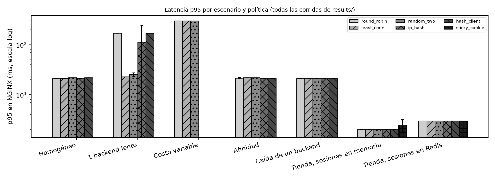
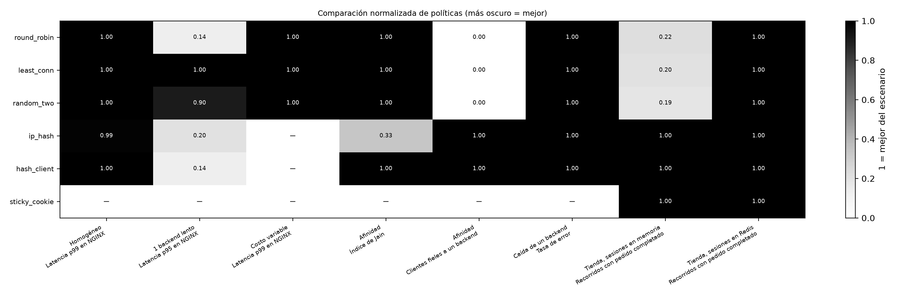
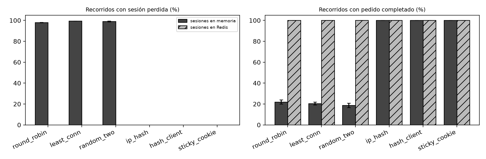

# Comparación de todas las políticas de balanceo en todos los escenarios

Generado por `analysis/compare_all.py` (`make compare`) a partir de los `resumen_comparativo.csv` de `results/` y `results/ejemplos/`. Para cada configuración se toma el lote con más repeticiones; valores = media ± desviación entre repeticiones. **En negrita, el mejor valor del escenario** (empates incluidos). `—` = combinación no medida.

## Escenarios

| Escenario | Qué se probó | Lotes |
|---|---|---|
| Homogéneo | 3 réplicas iguales, rampa 5→150 VU/s, espera de 20 ms (M-05, ALG) | `lote-ALG-actions`, `lote-test-min-reps3-actions` |
| 1 backend lento | 3 rápidas + 1 lenta (150 ms, 0,25 CPU), rampa (E-03) | `lote-E03-actions`, `lote-E03-hash-actions` |
| Costo variable | 90 % de 5 ms y 10 % de 300 ms de espera (E-04) | `lote-E04-actions` |
| Afinidad | misma IP, cliente lógico por X-Client-Id (E-05 y ALG) | `lote-ALG-actions`, `lote-E05-actions` |
| Caída de un backend | docker rm -f de 1 de 3 réplicas bajo 300 req/s (M-03) | `lote-M03-hash_client-actions`, `lote-M03-ip_hash-actions`, `lote-M03-random_two-actions`, `lote-test-min-reps3-actions` |
| Tienda, sesiones en memoria | compra completa con sesión en la réplica (E-16) | `lote-tienda-memory-actions` |
| Tienda, sesiones en Redis | compra completa con sesión compartida (E-16) | `lote-tienda-redis-actions` |

## Ganador por escenario

| Escenario | Métrica principal | Mejor política |
|---|---|---|
| Homogéneo | Latencia p99 en NGINX | empate (diferencia ≤ desviación): `round_robin`, `least_conn`, `random_two`, `hash_client` |
| 1 backend lento | Latencia p95 en NGINX | `least_conn` (23,0 ms vs 25,5 ms de `random_two`) |
| Costo variable | Latencia p99 en NGINX | empate (diferencia ≤ desviación): `round_robin`, `least_conn`, `random_two` |
| Afinidad | Clientes fieles a un backend | empate (diferencia ≤ desviación): `hash_client`, `ip_hash` |
| Caída de un backend | Tasa de error (5xx) en NGINX | empate (diferencia ≤ desviación): `round_robin`, `least_conn`, `random_two`, `ip_hash`, `hash_client` |
| Tienda, sesiones en memoria | Recorridos con sesión perdida | empate (diferencia ≤ desviación): `ip_hash`, `hash_client`, `sticky_cookie` |
| Tienda, sesiones en Redis | Latencia p95 en NGINX | empate (diferencia ≤ desviación): `round_robin`, `least_conn`, `random_two`, `ip_hash`, `hash_client`, `sticky_cookie` |

## Latencia media en NGINX (ms)

Menor es mejor.

| Política | Homogéneo | 1 backend lento | Costo variable | Afinidad | Caída de un backend | Tienda, sesiones en memoria | Tienda, sesiones en Redis |
|---|---|---|---|---|---|---|---|
| `round_robin` | **20,3 ± 0,0** | 58,2 ± 0,1 | 34,7 ± 0,0 | 20,4 ± 0,0 | **20,2** | 0,9 ± 0,0 | 1,4 ± 0,0 |
| `least_conn` | 20,3 ± 0,0 | **27,1 ± 0,0** | 34,8 ± 0,2 | 20,4 ± 0,0 | 20,4 | 0,8 ± 0,0 | 1,4 ± 0,0 |
| `random_two` | 20,4 ± 0,0 | 27,9 ± 0,1 | **34,7 ± 0,2** | 20,4 ± 0,0 | 20,8 | **0,8 ± 0,0** | 1,4 ± 0,1 |
| `ip_hash` | 20,3 ± 0,0 | 97,8 ± 109,7 | — | **20,1 ± 0,0** | 20,5 | 1,0 ± 0,0 | **1,2 ± 0,0** |
| `hash_client` | 20,4 ± 0,0 | 58,3 ± 0,2 | — | 20,3 ± 0,0 | 20,2 | 1,1 ± 0,0 | 1,4 ± 0,1 |
| `sticky_cookie` | — | — | — | — | — | 1,2 ± 0,3 | 1,3 ± 0,0 |

## Latencia p95 en NGINX (ms)

Menor es mejor.

| Política | Homogéneo | 1 backend lento | Costo variable | Afinidad | Caída de un backend | Tienda, sesiones en memoria | Tienda, sesiones en Redis |
|---|---|---|---|---|---|---|---|
| `round_robin` | **21,0** | 171,0 | **300,0** | 21,5 ± 0,7 | **21,0** | **2,0** | **3,0** |
| `least_conn` | **21,0** | **23,0** | **300,0** | 22,0 | **21,0** | **2,0** | **3,0** |
| `random_two` | 22,0 | 25,5 ± 2,1 | **300,0** | 22,0 | **21,0** | **2,0** | **3,0** |
| `ip_hash` | **21,0** | 113,5 ± 130,8 | — | **21,0** | **21,0** | **2,0** | **3,0** |
| `hash_client` | 22,0 | 171,0 | — | **21,0** | **21,0** | **2,0** | **3,0** |
| `sticky_cookie` | — | — | — | — | — | 2,5 ± 0,7 | **3,0** |

## Latencia p99 en NGINX (ms)

Menor es mejor.

| Política | Homogéneo | 1 backend lento | Costo variable | Afinidad | Caída de un backend | Tienda, sesiones en memoria | Tienda, sesiones en Redis |
|---|---|---|---|---|---|---|---|
| `round_robin` | **22,0** | 173,0 | **301,0** | 22,5 ± 0,7 | **22,0** | **3,0** | **5,0** |
| `least_conn` | **22,0** | 171,0 | **301,0** | **22,0** | **22,0** | **3,0** | **5,0** |
| `random_two` | **22,0** | 171,0 | **301,0** | **22,0** | **22,0** | **3,0** | 5,5 ± 0,7 |
| `ip_hash` | 22,3 ± 0,6 | **133,5 ± 157,7** | — | **22,0** | 23,0 | 4,0 | **5,0** |
| `hash_client` | **22,0** | 173,0 | — | **22,0** | **22,0** | 4,0 | **5,0** |
| `sticky_cookie` | — | — | — | — | — | 4,5 ± 0,7 | **5,0** |

## Goodput (respuestas correctas/s) (req/s)

Mayor es mejor.

| Política | Homogéneo | 1 backend lento | Costo variable | Afinidad | Caída de un backend | Tienda, sesiones en memoria | Tienda, sesiones en Redis |
|---|---|---|---|---|---|---|---|
| `round_robin` | 1137 ± 0 | 1135 ± 0 | 1135 ± 0 | 1137 ± 0 | 300 | 108 ± 0 | **108 ± 0** |
| `least_conn` | 1137 ± 0 | 1136 ± 1 | 1137 ± 2 | 1137 ± 0 | 300 | 108 ± 0 | 108 ± 0 |
| `random_two` | 1137 ± 0 | **1137 ± 0** | **1137 ± 1** | 1137 ± 0 | 300 | **108 ± 0** | 108 ± 0 |
| `ip_hash` | **1137 ± 0** | 1052 ± 120 | — | 1137 ± 0 | 300 | 108 ± 0 | 108 ± 0 |
| `hash_client` | 1137 ± 0 | 1135 ± 4 | — | **1137 ± 0** | **300** | 108 ± 0 | 108 ± 0 |
| `sticky_cookie` | — | — | — | — | — | 108 ± 0 | 108 ± 0 |

## Tasa de error (5xx) en NGINX (%)

Menor es mejor.

| Política | Homogéneo | 1 backend lento | Costo variable | Afinidad | Caída de un backend | Tienda, sesiones en memoria | Tienda, sesiones en Redis |
|---|---|---|---|---|---|---|---|
| `round_robin` | **0,000** | **0,000** | **0,000** | **0,000** | **0,000** | **0,000** | **0,000** |
| `least_conn` | **0,000** | **0,000** | **0,000** | **0,000** | **0,000** | **0,000** | **0,000** |
| `random_two` | **0,000** | **0,000** | **0,000** | **0,000** | **0,000** | **0,000** | **0,000** |
| `ip_hash` | **0,000** | **0,000** | — | **0,000** | **0,000** | **0,000** | **0,000** |
| `hash_client` | **0,000** | **0,000** | — | **0,000** | **0,000** | **0,000** | **0,000** |
| `sticky_cookie` | — | — | — | — | — | **0,000** | **0,000** |

## Índice de Jain (equidad)

Mayor es mejor.

| Política | Homogéneo | 1 backend lento | Costo variable | Afinidad | Caída de un backend | Tienda, sesiones en memoria | Tienda, sesiones en Redis |
|---|---|---|---|---|---|---|---|
| `round_robin` | **1,000** | **1,000 ± 0,000** | **1,000 ± 0,000** | **1,000 ± 0,000** | **0,718** | **1,000** | **1,000** |
| `least_conn` | 1,000 ± 0,000 | 0,816 ± 0,000 | 1,000 ± 0,000 | 1,000 ± 0,000 | 0,718 | 1,000 ± 0,000 | 1,000 ± 0,000 |
| `random_two` | 1,000 ± 0,000 | 0,823 ± 0,001 | 1,000 ± 0,000 | 1,000 ± 0,000 | 0,696 | 1,000 ± 0,000 | 1,000 ± 0,000 |
| `ip_hash` | 0,333 | 0,333 | — | 0,333 | 0,648 | 0,333 | 0,333 |
| `hash_client` | 1,000 ± 0,000 | 1,000 ± 0,000 | — | 1,000 ± 0,000 | 0,695 | 0,999 ± 0,000 | 0,999 ± 0,001 |
| `sticky_cookie` | — | — | — | — | — | 0,997 ± 0,003 | 0,999 ± 0,002 |

## Fracción al backend más cargado (%)

Menor es mejor.

| Política | Homogéneo | 1 backend lento | Costo variable | Afinidad | Caída de un backend | Tienda, sesiones en memoria | Tienda, sesiones en Redis |
|---|---|---|---|---|---|---|---|
| `round_robin` | **33,3** | **25,0 ± 0,0** | **33,3 ± 0,0** | **33,3 ± 0,0** | 40,5 | **33,3** | **33,3** |
| `least_conn` | 33,3 ± 0,0 | 31,9 ± 0,0 | 33,6 ± 0,3 | 33,3 ± 0,0 | 40,5 | 33,4 ± 0,0 | 33,5 ± 0,0 |
| `random_two` | 33,4 ± 0,0 | 31,7 ± 0,0 | 33,5 ± 0,0 | 33,4 ± 0,0 | **40,4** | 33,9 ± 0,4 | 33,6 ± 0,1 |
| `ip_hash` | 100,0 | 100,0 | — | 100,0 | 59,5 | 100,0 | 100,0 |
| `hash_client` | 33,5 ± 0,1 | 25,1 ± 0,0 | — | 33,6 ± 0,1 | 40,6 | 34,3 ± 0,3 | 34,2 ± 0,3 |
| `sticky_cookie` | — | — | — | — | — | 35,0 ± 0,7 | 34,5 ± 1,4 |

## Clientes fieles a un backend (%)

Mayor es mejor.

| Política | Homogéneo | 1 backend lento | Costo variable | Afinidad | Caída de un backend | Tienda, sesiones en memoria | Tienda, sesiones en Redis |
|---|---|---|---|---|---|---|---|
| `round_robin` | 0,1 ± 0,0 | 0,0 | 0,0 ± 0,0 | 0,1 ± 0,0 | 1,4 | 0,1 | 0,0 ± 0,1 |
| `least_conn` | 0,4 ± 0,0 | 0,2 ± 0,0 | **1,1 ± 0,1** | 0,3 ± 0,0 | 34,6 | 0,0 | 0,0 ± 0,1 |
| `random_two` | 0,0 ± 0,0 | 0,0 ± 0,0 | 0,2 ± 0,0 | 0,0 ± 0,0 | 33,4 | 0,1 ± 0,1 | 0,1 |
| `ip_hash` | **100,0** | **100,0** | — | **100,0** | **99,9** | **100,0** | **100,0** |
| `hash_client` | **100,0** | **100,0** | — | **100,0** | 99,9 | **100,0** | **100,0** |
| `sticky_cookie` | — | — | — | — | — | **100,0** | **100,0** |

## Reintentos (proxy_next_upstream)

Menor es mejor.

| Política | Homogéneo | 1 backend lento | Costo variable | Afinidad | Caída de un backend | Tienda, sesiones en memoria | Tienda, sesiones en Redis |
|---|---|---|---|---|---|---|---|
| `round_robin` | **0** | **0** | **0** | **0** | 3 | **0** | **0** |
| `least_conn` | **0** | **0** | **0** | **0** | 3 | **0** | **0** |
| `random_two` | **0** | **0** | **0** | **0** | 3 | **0** | **0** |
| `ip_hash` | **0** | **0** | — | **0** | **0** | **0** | **0** |
| `hash_client` | **0** | **0** | — | **0** | 3 | **0** | **0** |
| `sticky_cookie` | — | — | — | — | — | **0** | **0** |

## Recorridos con sesión perdida (%)

Menor es mejor.

| Política | Tienda, sesiones en memoria | Tienda, sesiones en Redis |
|---|---|---|
| `round_robin` | 97,9 ± 0,3 | **0,0** |
| `least_conn` | 99,4 ± 0,1 | **0,0** |
| `random_two` | 99,0 ± 0,5 | **0,0** |
| `ip_hash` | **0,0** | **0,0** |
| `hash_client` | **0,0** | **0,0** |
| `sticky_cookie` | **0,0** | **0,0** |

## Recorridos con pedido completado (%)

Mayor es mejor.

| Política | Tienda, sesiones en memoria | Tienda, sesiones en Redis |
|---|---|---|
| `round_robin` | 22,0 ± 2,0 | **100,0** |
| `least_conn` | 20,5 ± 1,3 | **100,0** |
| `random_two` | 18,7 ± 2,2 | **100,0** |
| `ip_hash` | **100,0** | **100,0** |
| `hash_client` | **100,0** | **100,0** |
| `sticky_cookie` | **100,0** | **100,0** |

## p95 de la compra (POST /api/orders, Artillery) (ms)

Menor es mejor.

| Política | Tienda, sesiones en memoria | Tienda, sesiones en Redis |
|---|---|---|
| `round_robin` | 2 ± 1 | **6 ± 1** |
| `least_conn` | 2 ± 1 | 6 |
| `random_two` | **2** | 6 ± 1 |
| `ip_hash` | 4 ± 1 | **6 ± 1** |
| `hash_client` | 4 ± 1 | 6 |
| `sticky_cookie` | 6 ± 3 | 6 |

## Figuras

