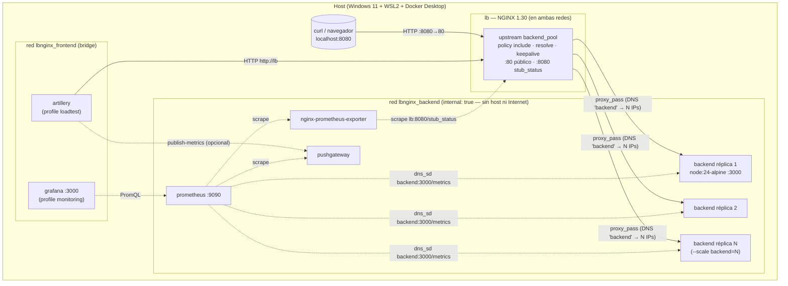
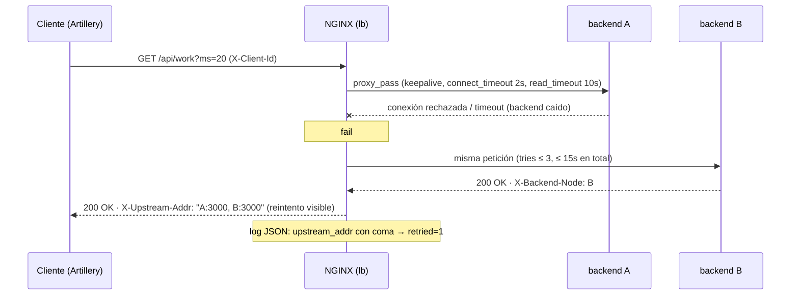
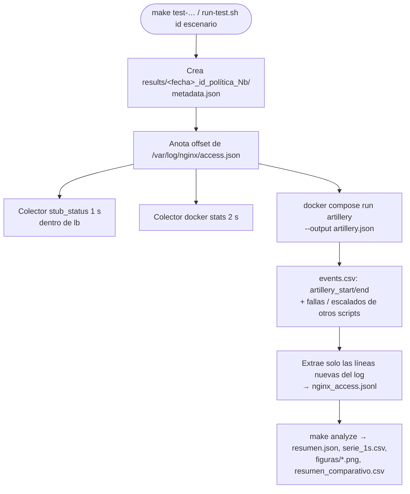

# Diagramas de arquitectura

Fuente de los diagramas (Mermaid). Para exportar a PNG sin instalar nada en el host:

```bash
docker run --rm -u "$(id -u):$(id -g)" -v "$PWD/docs/diagramas:/data" minlag/mermaid-cli:11.4.2 -i arquitectura.mmd -o arquitectura.png -b white -s 2
```

## 1. Arquitectura lógica, redes y flujos



## 2. Camino de una petición y detección pasiva de fallos



## 3. Flujo de una corrida de prueba (`scripts/run-test.sh`)


