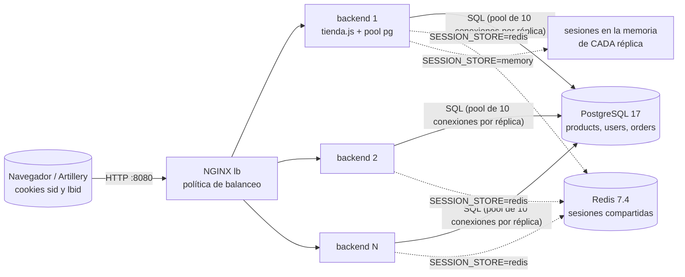

# TelemaShop: la aplicación con estado detrás del balanceador

Recomendación del profesor: probar el balanceador con una **página con funcionalidades y base de
datos**, no solo con una página estática. La tienda existe para eso: introduce **estado** (sesiones,
carrito y una base de datos compartida), que es justo donde aparecen los problemas reales del balanceo.

## Arquitectura



- **PostgreSQL** (`postgres:17-alpine`): 2000 productos en 8 categorías, 1000 usuarios
  (`usuario1` … `usuario1000`, contraseña `clave123`), pedidos y líneas de pedido. Esquema y datos en
  [`db/init/`](../db/init/); índice trigram para la búsqueda `ILIKE`.
- **Redis** (`redis:7.4-alpine`): sesiones compartidas por todas las réplicas, sin persistencia.
- **Backend** ([`backend/tienda.js`](../backend/tienda.js)): API JSON, pool de conexiones `pg`,
  compra transaccional (`BEGIN … UPDATE stock … INSERT orders … COMMIT`, bloqueo en orden fijo para
  evitar interbloqueos) y métricas Prometheus (`tienda_*`).
- **Página** ([`backend/public/index.html`](../backend/public/index.html)): catálogo con búsqueda y
  filtros, login, carrito, compra, pedidos por réplica y un panel de **diagnóstico del balanceo** que
  muestra en cada petición el nodo, la política, el upstream y la caché.

Base de datos y Redis viven solo en la red `internal` (sin puertos al host). `/health` indica que el
proceso vive; `/ready` que además responden PostgreSQL y el almacén de sesiones.

## API

| Método y ruta | Qué hace | Toca |
|---|---|---|
| `GET /` | página de la tienda | — |
| `GET /api/categories` | categorías con número de productos | PostgreSQL (`GROUP BY`) |
| `GET /api/products?q=&category=&page=&size=` | catálogo paginado y búsqueda | PostgreSQL |
| `GET /api/products/:id` | detalle | PostgreSQL |
| `POST /api/login` `{username, password}` | crea la sesión, cookie `sid` | PostgreSQL + sesiones |
| `GET /api/me` · `POST /api/logout` | sesión actual · cerrar sesión | sesiones |
| `GET/POST/DELETE /api/cart` | ver, agregar, vaciar el carrito | sesiones + PostgreSQL |
| `POST /api/orders` · `GET /api/orders` | comprar (transacción) · mis pedidos | PostgreSQL + sesiones |
| `GET /api/stats` | pedidos por réplica en los últimos 5 min | PostgreSQL |
| `GET /ready` | PostgreSQL y almacén de sesiones disponibles | ambos |

Si la réplica no conoce la sesión responde `401` con `code: SESSION_NOT_FOUND` y el mensaje
"la réplica X no conoce esta sesión"; si Redis no responde, `503 SESSION_STORE_UNAVAILABLE`; si
PostgreSQL no responde, `503 DB_UNAVAILABLE`.

## Uso

```bash
make up                        # levanta lb, 3 backends, PostgreSQL y Redis
# Navegador: http://localhost:8080  (usuario1 / clave123)
make sesiones S=memory         # sesiones en la memoria de cada réplica (recrea los backends)
make policy P=round_robin      # -> al recargar, "Sesión perdida": la réplica no conoce la sesión
make policy P=sticky_cookie    # -> afinidad por cookie del balanceador: la compra funciona
make sesiones S=redis          # sesiones compartidas: funciona con cualquier política
make db-shell                  # psql: select node, count(*) from orders group by node;
```

## Pruebas nuevas

| ID | Prueba | Escenario | Qué responde |
|---|---|---|---|
| E-16 | Sesiones por política y almacén | `tienda.yml` (portada → catálogo → búsqueda → detalle → login → 2 × agregar → carrito → compra) | ¿Qué combinación de política y almacén de sesiones conserva el carrito? |
| E-17 | Escalabilidad con base de datos compartida | `tienda-lectura.yml`, N = 1, 2, 3, 5 | ¿Escalar backends sirve cuando todos consultan la misma base de datos? |
| E-18 | Caída de PostgreSQL bajo carga | `tienda-lectura.yml`, PostgreSQL detenido 30 s | ¿Qué hace el balanceador cuando falla una dependencia compartida? ¿Amplifican los reintentos? |
| E-19 | Caída de Redis durante compras | `tienda.yml`, Redis detenido 30 s | ¿Se degrada con gracia (el catálogo sigue) o cae todo? |
| A-02 | Microcaché del catálogo | `tienda-lectura.yml`, `LB_FEATURE=none` vs `microcache` | ¿Cuánto alivia a la base de datos una caché de 1 s en NGINX? |

Comandos: `make test-tienda`, `make test-ext E=E17|E18|E19`, `make test-cache`. Resultados en
[`resultados-extendidos.md`](resultados-extendidos.md) y comparación de todas las políticas en
[`comparacion-algoritmos.md`](comparacion-algoritmos.md).

## Seguridad y limitaciones (declaradas)

- Contraseñas con SHA-256 + sal: suficiente para datos de prueba; en producción, scrypt/argon2.
- Cookies `HttpOnly; SameSite=Lax`. TLS opcional en el balanceador (A-03, `make tls-up`); con HTTPS
  habría que añadir `Secure` a las cookies.
- La microcaché solo almacena el catálogo público (`GET /api/products`, `/api/categories`): la clave
  de caché no incluye la cookie, así que cachear carrito o sesión filtraría datos entre usuarios.
- El stock es muy alto a propósito para que las pruebas no lo agoten.
