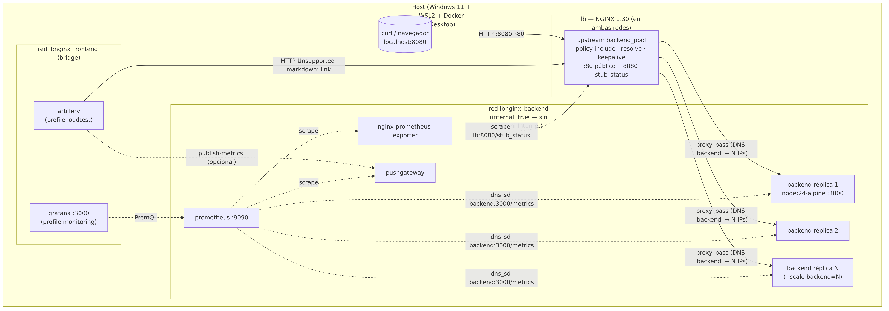

<!-- _class: lead -->
<!-- _paginate: false -->

# Balanceador de carga web con NGINX

### Clúster web contenedorizado, seis políticas de balanceo y pruebas de carga reproducibles con Artillery

**Fabio Jordan C. · Juan David Morales**
Servicios Telemáticos 2026-02 · Proyecto final 2 · Grupo 3 (Lista 1)

---

## Problema y objetivo

- Un único servidor web = **punto único de falla** + **techo de capacidad**: si cae, el servicio cae; si la demanda lo supera, la latencia crece hasta fallar.
- Un **balanceador L7** (proxy inverso) reparte las peticiones entre N backends equivalentes → escalado horizontal + tolerancia a fallos.

**Objetivo:** diseñar, implementar y evaluar experimentalmente un clúster web con balanceo NGINX, totalmente en Docker Compose, comparando algoritmos y caracterizando desempeño y resiliencia con Artillery.

---

## Conceptos del curso

| Concepto | En el proyecto |
|---|---|
| Sin balanceo vs con balanceo | E-01 (1 backend) vs 3, 5, 7 backends (E-02) |
| Balanceo L4 vs L7 | NGINX decide por cabeceras: `hash $http_x_client_id` es imposible en L4 |
| Proxy directo vs inverso | El cliente solo conoce al balanceador; backends sin puertos publicados |
| Round Robin, Leastconn, Source | `round_robin`, `least_conn`, `ip_hash` + `hash consistent`, `random two` |
| Alta disponibilidad y health checks | `max_fails`/`fail_timeout`, `proxy_next_upstream`, healthchecks Docker |
| Pruebas de carga con Artillery | usuarios concurrentes soportados y punto de quiebre (E-13) |

---

## Algoritmos de balanceo

| Política | Cómo decide | Advertencia |
|---|---|---|
| `round_robin` | turnos (ponderables) | ignora la carga real |
| `least_conn` | menos conexiones activas | ≈ RR con peticiones cortas |
| `ip_hash` | hash de la IP (**solo /24 en IPv4**) | toda una /24 → un backend |
| `hash_client` | hash **consistente** de `X-Client-Id` | el cliente debe enviar la cabecera |
| `random_two` | 2 al azar, el de menos conexiones | comparar con least_conn |

---

## Alternativas: matriz multicriterio 4.1

| Criterio (peso) · cómo se mide | NGINX | HAProxy | Traefik | Apache | LVS |
|---|---|---|---|---|---|
| C1 Desempeño (20) · **medido en A-05** (p99, CPU del balanceador) | 5 | **4** | 4 | 3 | 5 |
| C2 Algoritmos (15) · conteo en docs versión libre | 4 | 5 | 3 | 4 | 5 |
| C3 Detección de fallos (15) · activos+reintentos=5, pasivos=3 | 3 | 5 | 4 | 4 | 1 |
| C4 Observabilidad (10) · métricas por backend sin pago | 2 | 5 | 5 | 3 | 2 |
| C5 Facilidad (10) · líneas de config + encuesta | 4 | 3 | 4 | 3 | 2 |
| C6 Docker/descubrimiento (10) · réplicas nuevas sin reinicio | 4 | 4 | 5 | 2 | 1 |
| C7 Madurez (10) · años, releases, docs | 5 | 4 | 4 | 4 | 3 |
| C8 Funciones L7 (10) · estáticos, caché, TLS, rate limit | 5 | 3 | 3 | 4 | 1 |
| **Puntaje /100** | **81** | **84** | **79** | **68** | **56** |

---

## Sensibilidad y reflexión

- **A-05 medido:** misma carga, NGINX p99 32,5 ms con 11,6 % de CPU vs HAProxy 40,5 ms con 23,5 % (salvedad: HAProxy sin reutilizar conexiones) → C1 de HAProxy 5 → 4.
- Ventaja de HAProxy **pequeña y frágil** (84 vs 81): NGINX lidera si C4 baja a 5, o si C8 ≥ 17, C5/C7 ≥ 22, C1 ≥ 31.
- **HAProxy supera a NGINX** en balanceo puro (checks activos, métricas por backend). Lo decimos.
- NGINX se selecciona porque:
  1. es la restricción del proyecto asignado (requisito del cliente);
  2. queda a 3 puntos y **midió mejor latencia con la mitad de CPU**;
  3. funciones L7 completas en un solo componente (la microcaché bajó **77 %** la CPU de la base de datos);
  4. las debilidades se **mitigan en el diseño**: detección pasiva + reintentos (C3), exporter + logs JSON + `/metrics` por réplica (C4), `resolve` (C6).
- Matriz 4.3 (descubrimiento): DNS con `resolve` 78 > regenerar+reload 64 > estáticos 60.

---

## Arquitectura

Dos redes con nombre: <code>lbnginx_frontend</code> (publica :8080) y <code>lbnginx_backend</code> (<code>internal: true</code>). Config NGINX 100 % externa (volúmenes :ro + envsubst). Política = un archivo. Backend instrumentado (X-Backend-Node, fallos, /metrics).

---

## Cumplimiento de requisitos (resumen)

| Bloque | Requisitos | Evidencia |
|---|---|---|
| Infraestructura | R-07 upstream ≥ 3 · R-08 RR/least_conn/ip_hash · R-09 stub_status · R-10 timeouts/reintentos | `nginx/templates/http.conf.template`, `nginx/policies/` |
| Pruebas | R-11 rampa · R-12 comparación · R-13 fallos durante la prueba | `artillery/scenarios/`, `scripts/test-*.sh` |
| Docker | R-14 compose · R-15 nginx.conf volumen · R-16 redes/sin puertos · R-17 .env · R-18 Prometheus · R-19 override hot-reload · R-20 README | `docker-compose*.yml`, `monitoring/`, `README.md` |
| Mínimas | R-21 stub_status por algoritmo · R-22 resiliencia · R-23 1000 usuarios · R-24 media/p99 · R-25 logs | `results/`, `docs/figuras/` |

Más allá: 6 políticas, inyección de 7 modos de falla, escalado en caliente sin reload, Grafana aprovisionado, análisis automático, rate limiting, microcaché, comparativa HAProxy, CI.

---

## Demo en vivo (7 min)

1. `docker compose ps` → backends, PostgreSQL y Redis sin `0.0.0.0:`
2. **La tienda** en `localhost:8080`: buscar, login, carrito, compra; panel de diagnóstico muestra qué réplica atiende
3. `make sesiones S=memory` → "Sesión perdida" · `make policy P=sticky_cookie` → el carrito se conserva
4. Carga constante + Grafana: distribución por réplica en vivo
5. `make policy P=ip_hash` → todo a un backend (la /24) · `P=hash_client` → se reparte
6. `scripts/inject-fault.sh rm 1` → redistribución, error ≈ 0
7. `make scale N=5` → réplicas nuevas **sin reiniciar NGINX**

---

## Resultados: pruebas mínimas (3 repeticiones, GitHub Actions 2 vCPU)

| Prueba | Resultado medido |
|---|---|
| M-00 / M-02 reparto | 10/10/10 · 1000 secuenciales: 334/333/333, **Jain 1,000** |
| M-03 retirar un backend bajo 300 req/s | **100 % disponibilidad**, 0 errores, 3 reintentos, p99 22 ms estable |
| M-04 1000 usuarios concurrentes | 3/3 reps: **meseta de 1000 activos 60 s**, 0 fallidos, p99 ≤ 76 ms |
| M-05 round_robin vs least_conn vs ip_hash | media 20,30 / 20,35 / 20,33 ms · p99 22 ms → **no distinguibles** |
| M-06 logs vs Artillery | coincidencia **100 %**; ip_hash: **100 % a un solo backend** |

Fuente: results/ejemplos/lote-test-min-reps3-actions · el generador (Artillery) fue el cuello de botella: NGINX ≤ 14 % CPU.

---

## Resultados: algoritmos y la trampa de ip_hash

- Homogéneos y peticiones baratas: **round-robin ≈ least_conn** (hipótesis confirmada).
- `ip_hash` usa la /24 → toda la carga de Artillery en un nodo. Afinidad correcta: **L7** con `hash $http_x_client_id`.

---

## Resultados: backends heterogéneos (E-03)

3 réplicas rápidas + 1 lenta (150 ms, 0,25 CPU):

| Política | Media | p95 | % al lento |
|---|---|---|---|
| round_robin | 58,2 ms | **171 ms** | 25 % |
| round_robin 3:1 | 35,5 ms | 171 ms | 10 % |
| **least_conn** | **27,1 ms** | **23 ms** | **4,5 %** |
| random_two | 27,9 ms | 25,5 ms | 4,9 % |

`least_conn` ve que el lento acumula conexiones y lo evita. Con peticiones que solo **esperan** (E-04) no hay diferencia: un temporizador no forma cola.

---

## Resultados: resiliencia (M-03 / E-07 / E-09)

| Falla | Errores (30 s) | p99 |
|---|---|---|
| stop / kill / crash | **0** | 22 ms |
| pause / hang | 9 (0,1 %) | **10 s** (= proxy_read_timeout) |
| responde 500 | **3001 (33 %)** — NGINX no reintenta 500 | 22 ms |
| sin backends (E-09) | página de mantenimiento 30 s → recupera en **0,84 s** | — |

---

## Resultados: escalabilidad y punto de quiebre (E-02 / E-13)

Endpoint con 3 ms de CPU: goodput **170 → 271 → 472 → 783 req/s** para N = 1, 2, 3, 5 (error 81 % → 0 %), eficiencia 0,79–0,92. Quiebre (error < 1 %, p99 < 1 s): ~185 / 582 / 875 req/s con 1 / 3 / 5 réplicas.

---

## Una aplicación con estado: TelemaShop

Recomendación del profesor: probar con **funcionalidades y base de datos**, no solo una página.

- Catálogo y búsqueda, login, carrito y **compra transaccional** sobre **PostgreSQL 17** (compartido por todas las réplicas)
- Sesiones en **Redis** (compartidas) o en la **memoria** de cada réplica (`SESSION_STORE`)
- Nueva política **`sticky_cookie`**: NGINX emite la cookie `lbid` y hace hash de ella
- Recorrido de compra en Artillery: portada → catálogo → búsqueda → detalle → login → 2 × carrito → compra
- Métricas en Grafana: sesiones perdidas, pedidos por réplica, pool de PostgreSQL

---

## Resultados: ¿sobrevive la sesión al balanceo? (E-16)

| | Memoria: sesión perdida | Memoria: compras OK | Redis: compras OK |
|---|---|---|---|
| round_robin / least_conn / random_two | **98–99 %** | ~20 % | **100 %** |
| ip_hash / hash_client / sticky_cookie | 0 % | **100 %** | **100 %** |

Con sesión local, la afinidad es obligatoria; con Redis, cualquier algoritmo sirve.

---

## Resultados: la base de datos compartida (E-17, A-02, E-18/19)

- **E-17:** de 1 a 5 réplicas, la CPU por réplica baja de 21 % a 9 %… pero **PostgreSQL sigue en ~23 %**: escalar backends no escala la base de datos.
- **A-02 microcaché de 1 s** (solo catálogo público): 61,6 % de aciertos, CPU de PostgreSQL **−77 %**, latencia media 1,24 → 0,28 ms.
- **E-18 PostgreSQL caído 30 s:** 100 % de errores (inevitable) y **6,3 s** extra de recuperación.
- **E-19 Redis caído:** fallaron login y carrito… **y también el catálogo**, que no usa Redis.
- Causa (H-8): los 503 de la app cuentan como fallo en `proxy_next_upstream` → NGINX descarta las réplicas **sanas**.

---

## Hallazgos (lo que no estaba en el enunciado)

1. **`hash … consistent` + `resolve` no da afinidad** en NGINX 1.30.6 (0 % de clientes fieles). Hash simple: 100 %, pero al pasar de 5 a 4 réplicas **remapea al 84 %** de los clientes (E-06).
2. **Errores 500 y lentitud son invisibles** para la detección pasiva de NGINX OSS.
3. **`resolve` envía tráfico antes del healthcheck** de Docker.
4. **La afinidad no puede basarse en la cookie de la app:** el login llega sin cookie y cae en otro nodo (4 de 5 compras perdidas). La cookie la debe emitir el balanceador.
5. **El 503 de una dependencia caída tumba réplicas sanas** en la detección pasiva.

→ Matriz 4.3: si la afinidad estable pesara ≥ 15/100, convendría regenerar la configuración en lugar de `resolve`.

---

## Matriz 4.2 y conclusiones

- **Algoritmo recomendado (matriz 4.2, todos los criterios medidos): `least_conn` (92,0)** > random_two (87,5) > hash_client (76,0) > round_robin (71,6) > ip_hash (67,2). Estable con ±5 en cualquier peso; hash_client ganaría solo si la afinidad pesara ≥ 26/100.
- Homogéneos: no importa el algoritmo. Heterogéneos en **capacidad**: `least_conn` (p95 171 → 23 ms).
- Con estado: **sesiones en Redis + `least_conn`**; si la sesión no puede salir de la réplica, `sticky_cookie`.
- Base de datos: escalar backends no la alivia; la **microcaché** sí (−77 % CPU).
- Resiliencia: caídas sin errores; cuelgues cuestan el timeout; 500 requiere `proxy_next_upstream http_500`.
- Limitación: 2 vCPU → generador como cuello de botella; capacidad medida con costo de CPU.
- Trabajo futuro: HA del balanceador (keepalived/VRRP), health checks activos, TLS/HTTP2, Kubernetes.

---

<!-- _class: lead -->

# ¿Preguntas?

Repositorio: `lb-nginx-telematicos` · `make up && make smoke`
Referencias: NGINX docs (upstream, stub_status), Artillery docs, Little (1961), Jain (1984), Mitzenmacher (2001), Karger (1997)
