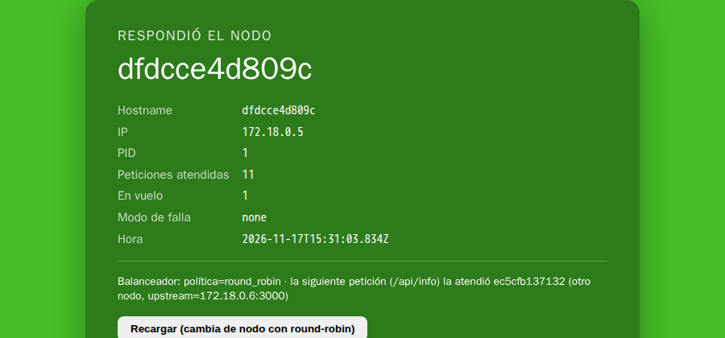
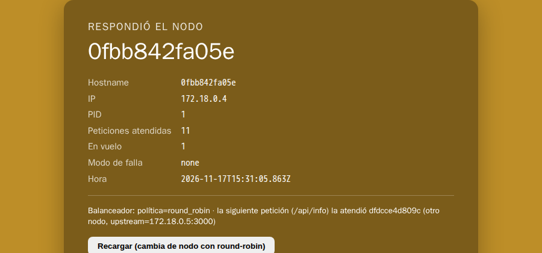
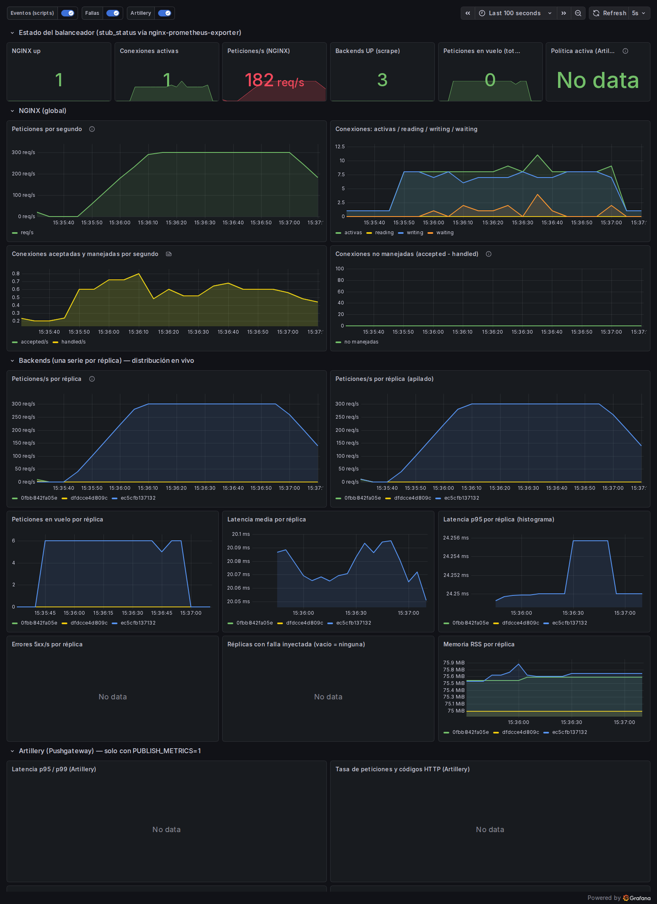
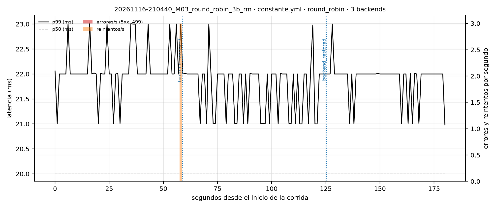
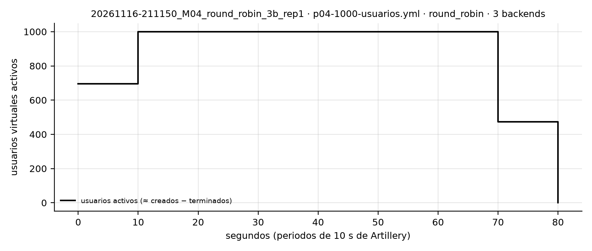
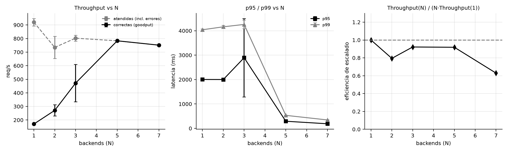
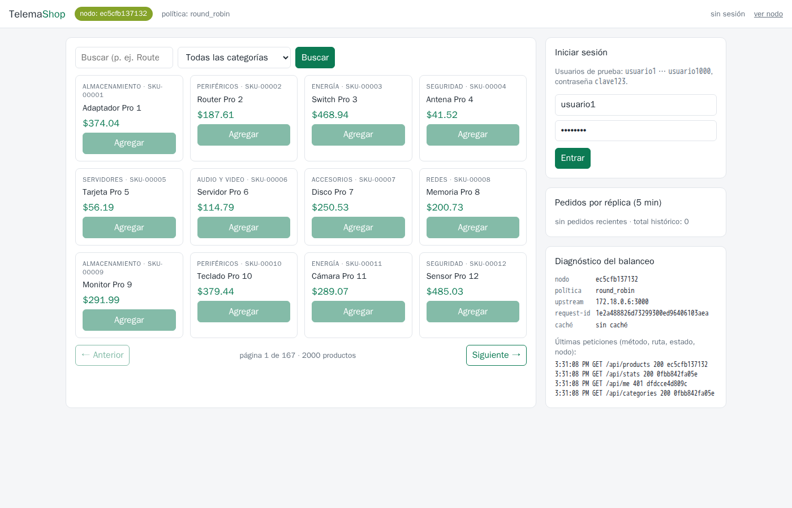
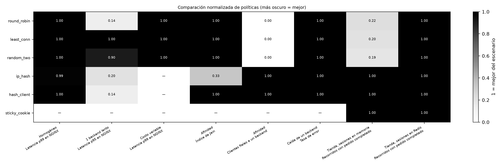

<!-- _class: lead -->
<!-- _paginate: false -->

# Balanceador de carga web con NGINX

### Clúster web contenedorizado, siete políticas de balanceo, una tienda con estado y pruebas de carga reproducibles con Artillery

**Fabio Jordan C. · Juan David Morales**
Servicios Telemáticos 2026-02 · Proyecto 2 · Grupo 3 (Lista 1)

---

## El proyecto en cifras

<div class="kpis">
<div class="kpi"><b>25 / 25</b>requisitos del enunciado cumplidos con evidencia</div>
<div class="kpi"><b>195</b>corridas reales en 36 lotes, todas versionadas</div>
<div class="kpi"><b>7</b>políticas de balanceo intercambiables con un comando</div>
<div class="kpi"><b>11</b>hallazgos técnicos documentados</div>
<div class="kpi"><b>0</b>errores al retirar un backend bajo 300 req/s</div>
<div class="kpi"><b>1000</b>usuarios concurrentes sostenidos 60 s, 0 fallidos</div>
<div class="kpi"><b>171 → 23 ms</b>p95 con un backend lento al usar least_conn</div>
<div class="kpi"><b>×4,6</b>goodput al pasar de 1 a 5 réplicas</div>
<div class="kpi"><b>−77 %</b>CPU de PostgreSQL con microcaché de 1 s</div>
<div class="kpi"><b>100 %</b>compras completas con sesiones en Redis</div>
<div class="kpi"><b>3,5 s</b>failover del propio balanceador (keepalived)</div>
<div class="kpi"><b>6 / 6</b>mejoras avanzadas implementadas y medidas</div>
</div>

<div class="fuente">Fuente de todas las cifras: <code>results/ejemplos/</code> (GitHub Actions, 2 vCPU), analizadas en contenedor con <code>analysis/</code>.</div>

---

## Problema, objetivo y conceptos del curso

<div class="c64">
<div>

**Problema.** Un solo servidor web es un **punto único de falla** (si cae, el servicio cae) y un **techo de capacidad** (si la demanda lo supera, la latencia crece hasta fallar).

**Solución.** Un **balanceador de capa 7** (proxy inverso) que reparte las peticiones entre N backends equivalentes: escalado horizontal y tolerancia a fallos.

**Objetivo.** Diseñar, implementar y evaluar un clúster web con NGINX, **todo en Docker Compose**, comparando algoritmos y midiendo desempeño y resiliencia con Artillery.

</div>
<div>

| Concepto | Dónde se ve |
|---|---|
| Sin vs con balanceo | E-02: 1 a 7 réplicas |
| Capa 4 vs capa 7 | hash por cabecera, solo en L7 |
| Proxy inverso | backends sin puertos al host |
| RR, leastconn, source | 3 del enunciado + 4 más |
| Alta disponibilidad | reintentos, keepalived |
| Pruebas de carga | rampa, 1000 usuarios, quiebre |

</div>
</div>

---

## Requisitos del enunciado → evidencia

<div class="small">

| Requisito del catálogo (Proyecto 2) | Cómo se cumple | Evidencia |
|---|---|---|
| `upstream` a ≥ 3 backends; round-robin, least_conn, ip_hash | 3 réplicas escalables a 7; un archivo por política, + 4 más | `make smoke`: 10/10/10; M-05 |
| `stub_status`; timeouts y reintentos | :8080 solo redes privadas; `proxy_*_timeout`, `proxy_next_upstream` | capturas de 7 políticas; E-08 |
| Artillery con ramp-up; comparar algoritmos; fallo de backends | `rampa.yml`; 3 repeticiones; 7 modos de falla bajo carga | M-03, M-05, E-03, E-07 |
| Compose con NGINX, 3 backends y Artillery; `nginx.conf` como volumen | servicios `lb`, `backend`, `artillery`; bind mounts `:ro` | `make up`, `docker inspect` |
| Red con nombre; backends sin puertos; `.env` con workers, puerto y política | `lbnginx_frontend` / `lbnginx_backend` (`internal`); `.env.example` | `make ps` |
| Prometheus + exporter (valorado); override con recarga en caliente | + Grafana aprovisionado; watcher `nginx -t && reload` | capturas; E-11 |
| README con diagrama, comandos y resultados | paso a paso, resultados y cumplimiento R-01…R-25 | `README.md` |

**Pruebas mínimas:** capturas de `stub_status` por algoritmo <span class="ok">✔</span> · retirar un backend: 100 % disponibilidad <span class="ok">✔</span> · 1000 usuarios 60 s <span class="ok">✔</span> · media y p99 por algoritmo <span class="ok">✔</span> · distribución desde los logs <span class="ok">✔</span>

</div>

---

## Selección de la tecnología: matriz 4.1

<div class="c64">
<div>

| Criterio (peso) · cómo se mide | NGINX | HAProxy | Traefik | Apache | LVS |
|---|---|---|---|---|---|
| C1 Desempeño (20) · **medido** | 5 | 5 | 3 | 4 | 5† |
| C2 Algoritmos (15) · docs | 4 | 5 | 3 | 3 | 5 |
| C3 Fallos (15) · docs | 3 | 5 | 5 | 5 | 1 |
| C4 Observabilidad (10) · docs | 2 | 5 | 4 | 3 | 4 |
| C5 Facilidad (10) · **medido** | 4 | 4 | 3 | 3 | 2 |
| C6 Descubrimiento (10) | 4 | 4 | 5 | 3 | 1 |
| C7 Madurez (10) | 5 | 5 | 4 | 5 | 4 |
| C8 Funciones L7 (10) | 5 | 4 | 3 | 4 | 1 |
| **Puntaje /100** | **81** | **94** | **74** | **76** | **62** |

</div>
<div>

**Proceso:** criterios con peso → **cómo se mide** → escala 1–5 con umbrales fijados antes → sensibilidad → reflexión.

**Medido (misma carga, 3 rep.)**

| | p99 | CPU LB | Líneas |
|---|---|---|---|
| NGINX | 35,7 ms | 9,9 % | 20 |
| HAProxy | 36,0 ms | 10,9 % | 18 |
| Apache | 38,0 ms | 19,6 % | 23 |
| Traefik | 41,2 ms | 28,1 % | 27 |

<div class="fuente">† LVS no medible en contenedores: 5 por diseño, declarado. Escalas en el respaldo.</div>

</div>
</div>

---

## Reflexión de la matriz y descubrimiento de backends

<div class="cols">
<div>

**Matriz 4.1**
- **No elige NGINX: HAProxy gana por 13 puntos** (checks activos y pasivos, más algoritmos y métricas por servidor). Estable con ±5 en cualquier peso.
- NGINX y HAProxy **empatan en desempeño**; al medir, la ventaja de HAProxy creció de 3 a 13.
- NGINX es **requisito del cliente**: la matriz valida la elección y expone su costo. Sus debilidades se mitigan en el diseño (reintentos, exporter + logs, `resolve`).
- Sin esa restricción, recomendaríamos HAProxy.

</div>
<div>

**Matriz 4.3: descubrimiento**

| Alternativa | Puntaje |
|---|---|
| **DNS con `resolve`** (elegida) | **78** |
| Regenerar config + reload | 58 |
| Servidores estáticos | 56 |

Docker resuelve `backend` a todas las réplicas y NGINX lo re-resuelve cada 5 s: **escalar sin recargar**. Tras H-1, conviene regenerar solo si la afinidad estable pesara ≥ 20/100.

</div>
</div>

---

## Arquitectura e implementación


<div class="cols">
<div>

```nginx
upstream backend_pool {
  zone backend_pool 128k;
  include policies/${LB_POLICY}.conf;
  server backend:3000 resolve max_fails=3 fail_timeout=10s;
  keepalive 64;
}
```

</div>
<div class="small">

**Dos redes con nombre:** solo el LB publica :8080; `lbnginx_backend` es `internal: true`. **Configuración 100 % externa** (volúmenes `:ro` + `envsubst`).

**7 políticas**, una por archivo: `round_robin`, `least_conn`, `random_two`, `ip_hash` (/24), `hash_remote_addr`, `hash_client` (hash simple) y `sticky_cookie` (cookie del LB). `make policy P=…` · `make scale N=5` sin recargar.

</div>
</div>

---

## Metodología y observabilidad

<div class="cols">
<div>

**Pruebas reproducibles**
- Todo en contenedores: Artillery, análisis y gráficas
- **3 repeticiones**, orden aleatorio, 30 s de calentamiento descartados
- `metadata.json` con la configuración **efectiva** de NGINX
- Diferencia ≤ desviación → **no distinguibles**
- Log de NGINX contrastado con Artillery

**Escenarios:** `rampa` · `1000 usuarios` (ley de Little) · `constante` (fallas) · `quiebre` · `soak` 15 min · `tienda` · `ratelimit`

</div>
<div>

<div style="height:300px;overflow:hidden;border-radius:6px"></div>

<div class="small">

`stub_status` → exporter → Prometheus → **Grafana aprovisionado**: req/s, latencia, errores y memoria por réplica; eventos anotados en las gráficas.

</div>
</div>
</div>

---

## M-00 a M-02 y M-06: así reparte cada algoritmo

<div class="c46">
<div>

<div class="cols3">
<div>


</div>
<div>



</div>
<div>



</div>
</div>

<div class="small">

Tres visitas a `/nodo` con round-robin: otro nodo, otro color.

| Política | Respuestas por backend |
|---|---|
| round_robin | 7 500 / 7 500 / 7 500 |
| least_conn, random_two, hash_client, sticky_cookie | ≈ 7 500 cada uno |
| ip_hash, hash_remote_addr | 22 500 / 0 / 0 |

M-02: 1000 secuenciales → 334/333/333, **Jain 1,000** · M-06: log = Artillery **100 %**

</div>
</div>
<div>

<div class="small">round_robin: 100 req/s por réplica</div>
<div style="height:150px;overflow:hidden"></div>
<div class="small">ip_hash: 300 req/s a una sola réplica (una sola IP de origen)</div>
<div style="height:150px;overflow:hidden"></div>

</div>
</div>

---

## M-03 y M-04: resiliencia y 1000 usuarios concurrentes

<div class="cols">
<div>

**M-03:** `docker rm -f` de una réplica bajo 300 req/s



**100 %** disponibilidad · **0** errores · 3 reintentos · p99 **22 ms** estable

</div>
<div>

**M-04:** 1000 llegadas en 10 s × sesiones de ~70 s (ley de Little)



Meseta de **1000 activos durante 60 s**, **0 fallidos**, p99 ≤ 76 ms en **3 de 3** repeticiones

</div>
</div>

---

## M-05 y E-03: ¿cuándo importa el algoritmo?

<div class="cols">
<div>

**M-05: backends iguales** (`rampa.yml`)

| Política | Media | p99 |
|---|---|---|
| round_robin | 20,30 ms | 22 ms |
| least_conn | 20,35 ms | 22 ms |
| ip_hash | 20,33 ms | 22 ms |

**No distinguibles.** Pero `ip_hash` mandó todo a un backend: usa la /24.

</div>
<div>

**E-03: un backend lento** (150 ms, 0,25 CPU)

| Política | p95 | Al lento |
|---|---|---|
| round_robin | **171 ms** | 25 % |
| RR con peso 3:1 | 171 ms | 10 % |
| **least_conn** | **23 ms** | **4,5 %** |
| random_two | 25,5 ms | 4,9 % |

`least_conn` ve que el lento acumula conexiones y lo evita.

</div>
</div>

<div class="nota">Con backends iguales el algoritmo no importa; con capacidad distinta, <code>least_conn</code> reduce el p95 de 171 a 23 ms.</div>

---

## E-02 y E-13: escalabilidad y punto de quiebre

<div class="c64">
<div>



</div>
<div>

**E-02** (3 ms de CPU por petición)

| Réplicas | Goodput | Errores |
|---|---|---|
| 1 | 170 req/s | 81,5 % |
| 2 | 271 req/s | 62,6 % |
| 3 | 472 req/s | 41,0 % |
| 5 | **783 req/s** | **0 %** |
| 7 | 751 req/s | 0 % |

**×4,6 con 5 réplicas**, eficiencia 0,79–0,92.

**E-13:** carga máxima con error < 1 % y p99 < 1 s: **185 / 582 / 875 req/s** con 1 / 3 / 5 réplicas.

</div>
</div>

---

## Fallas y operación en caliente

<div class="cols">
<div>

| Modo de falla (E-07) | Errores 30 s | p99 |
|---|---|---|
| stop / kill / crash | **0** | 22 ms |
| pause / hang | 9 (0,1 %) | 10 s |
| responde 500 | **33 %** | 22 ms |

**E-08:** con timeout de 3 s + reintentos, **0 errores** y p99 3 s; con 10 s el nodo colgado nunca se marca caído. Regla: `max_fails × timeout < fail_timeout`.

**E-09:** sin backends, página de mantenimiento; recupera en **0,84 s**.

</div>
<div>

| Operación bajo carga | Resultado |
|---|---|
| E-10 escalar 3 → 6 réplicas | **0 errores** |
| E-10 reducir 6 → 2 | 1 error en 54 000 |
| E-11 recargar la configuración | **0 errores** |
| E-14 pico ×16 de la tasa | **0 errores** |
| E-15 15 min continuos | 360 000 peticiones, **0 errores** |
| E-12 keepalive on/off | no distinguibles |
| E-06 de 5 a 4 réplicas con hash | remapea el **84 %** de los clientes |

</div>
</div>

---

## Matriz 4.2: algoritmo recomendado con datos medidos

| Política | p99 homog. (20) | p95 un lento (25) | Jain (15) | Errores al caer (20) | Afinidad (10) | Simplicidad (10) | **/100** |
|---|---|---|---|---|---|---|---|
| **least_conn** | 5,0 (22 ms) | **5,0 (23 ms)** | 5,0 | 5,0 (0 %) | 1,0 | 5 | **92,0** |
| random_two | 5,0 (22 ms) | 4,5 (25,5 ms) | 5,0 | 5,0 (0 %) | 1,0 | 4 | 87,5 |
| hash_client | 5,0 (22 ms) | 1,0 (171 ms) | 5,0 | 5,0 (0 %) | **5,0** | 2 | 74,0 |
| round_robin | 4,9 (22,5 ms) | 1,0 (171 ms) | 5,0 | 5,0 (0 %) | 1,0 | 5 | 71,6 |
| ip_hash | 4,8 (23 ms) | 1,0 (113,5 ms) | 1,7 | 5,0 (0 %) | 5,0 | 5 | 69,2 |

- **Recomendación: `least_conn`.** Iguala a las demás con backends iguales y es la que mejor protege la latencia si uno se degrada.
- Estable con ±5 en cualquier peso; `hash_client` ganaría solo si la afinidad pesara **≥ 27/100**.

<div class="fuente">Todos los criterios medidos. Normalización: menor es mejor 5·mejor/valor; Jain 5·J; errores 5·(1 − min(e, 5 %)/5 %); simplicidad por líneas de la política y requisitos al cliente.</div>

---

## TelemaShop: ¿sobrevive la sesión al balanceo? (E-16)

<div class="c46">
<div>



<div class="small">

Recomendación del profesor: **una aplicación con funcionalidades y base de datos.** Catálogo de 2000 productos, login, carrito y compra transaccional sobre **PostgreSQL 17**; sesiones en **Redis** o en la **memoria** de cada réplica.

</div>
</div>
<div>

| Política | Memoria: sesión perdida | Memoria: compras OK | Redis: compras OK |
|---|---|---|---|
| round_robin | 97,9 % | 22,0 % | **100 %** |
| least_conn | 99,4 % | 20,5 % | **100 %** |
| random_two | 99,0 % | 18,7 % | **100 %** |
| ip_hash | 0 % | 100 % | **100 %** |
| hash_client | 0 % | 100 % | **100 %** |
| sticky_cookie | 0 % | 100 % | **100 %** |

**Con sesión local la afinidad es obligatoria; con Redis cualquier algoritmo sirve.** `sticky_cookie`: el LB emite su propia cookie (H-6).

</div>
</div>

---

## La base de datos compartida: el nuevo cuello de botella

<div class="cols">
<div>

**E-17:** de 1 a 5 réplicas, la CPU por réplica baja de 21 % a 9 %, pero **PostgreSQL sigue en ~23 %**.

**A-02 microcaché de 1 s** en NGINX (solo catálogo público):


61,6 % de aciertos · CPU de PostgreSQL **22,6 → 5,1 % (−77 %)** · latencia 1,24 → 0,28 ms

</div>
<div>

**E-18 / E-19: cae una dependencia 30 s**

| | Antes (H-8) | Corregido |
|---|---|---|
| Réplicas sanas descartadas | 99,9 % | **0 %** |
| Catálogo con Redis caído | 27,8 % errores | **0 %** |
| Recuperación tras PostgreSQL | 6,3 s | **1,3 s** |

**Causa:** el 503 de la aplicación contaba como fallo en `proxy_next_upstream` y NGINX descartaba réplicas sanas. **Corrección:** sin `http_503`, adoptada por defecto.

</div>
</div>

---

## Mejoras avanzadas: A-01 a A-06

| Mejora | Resultado medido (3 repeticiones) |
|---|---|
| **A-01** límite de 50 req/s por cliente | cliente abusivo: **35,9 % de 429** (2 571; el límite predice ≈ 2 600) · clientes normales: **0 rechazos**, mismo p95 · backends −24 % |
| **A-02** microcaché de 1 s | CPU de PostgreSQL **−77 %** |
| **A-03** TLS 1.3 + HTTP/2 | negocia **ALPN h2** · latencia igual (p95 22 ms) · CPU del LB 6,0 → **8,1 %** |
| **A-04** 2 NGINX + keepalived + IP flotante | kill del activo: el respaldo responde en **3,5 s**, disponibilidad **99,95 %**; con `nopreempt`, **0 errores** al volver el principal (con preempción, 9) |
| **A-05** NGINX vs HAProxy, Traefik, Apache | misma carga: NGINX y HAProxy **empatan** (p99 35,7 / 36,0 ms); alimenta la matriz 4.1 |
| **A-06** integración continua | cada cambio valida Compose y `nginx -t`, humo, compra en la tienda, sesiones, TLS y 429; compila informe y diapositivas |

<div class="fuente">Fuente: <code>results/ejemplos/avanzadas.md</code> y lotes A01, A03, A04, A05B. La IP flotante de A-04 existe solo dentro de la red Docker.</div>

---

## Hallazgos: lo que no estaba en el enunciado

<div class="small">

| # | Hallazgo | Consecuencia |
|---|---|---|
| H‑1 | `hash … consistent` + `resolve` no da afinidad en NGINX 1.30.6 | `hash_client` con hash simple; remapeo del 84 % al escalar |
| H‑3 | `resolve` envía tráfico antes del healthcheck de Docker | lo mitigan la detección pasiva y los reintentos |
| H‑4 | Errores 500 y lentitud son invisibles para la detección pasiva | 33 % de errores con un backend que responde 500 |
| H‑5 | Con 2 vCPU el generador de carga es el cuello de botella | capacidad medida con costo de CPU |
| H‑6 | La afinidad no puede basarse en la cookie de la aplicación | el LB emite su propia cookie `lbid` |
| H‑8 | El 503 de una dependencia tumba réplicas sanas | sin `http_503`: recuperación 6,3 → 1,3 s |
| H‑9 | Cambios de `.env` a mitad de un lote no llegaban a los scripts | `metadata.json` guarda la configuración efectiva |
| H‑10 | El tiempo de respuesta de Artillery no incluye la conexión | TLS y failover medidos con la duración de la sesión |
| H‑11 | VRRP con preempción corta dos veces | `nopreempt` por defecto |

</div>

---

## Conclusiones

<div class="cols">
<div>

**Sobre el balanceo**
- Aporta **disponibilidad** (0 errores al perder un backend) y **capacidad casi lineal** (×4,6 con 5 réplicas).
- Con backends iguales el algoritmo no importa; con capacidad distinta, **`least_conn`** (p95 171 → 23 ms). Es la recomendación de la matriz 4.2 (92/100).
- Los cuelgues cuestan el timeout: **3 s + reintentos**.

</div>
<div>

**Sobre un servicio real**
- Con estado importa más **dónde vive la sesión** que el algoritmo: Redis + `least_conn`, o `sticky_cookie` si la sesión no puede salir de la réplica.
- La base de datos no escala con los backends; la **microcaché** sí la alivia.
- El propio balanceador deja de ser punto único de falla con **keepalived** (3,5 s).

**Trabajo futuro:** health checks activos, HA de PostgreSQL y Redis, TLS hasta los backends, Kubernetes.

</div>
</div>

---

## Demostración en vivo

<div class="cols">
<div>

1. **Despliegue:** `make up` y `make ps` → backends, PostgreSQL y Redis sin puertos al host
2. **Reparto:** `make smoke` y la página `/nodo` cambiando de nodo
3. **La tienda** en `localhost:8080`: login, carrito y compra; el panel muestra qué réplica atiende
4. **Sesiones:** `make sesiones S=memory` → «Sesión perdida»; `make policy P=sticky_cookie` → el carrito se conserva

</div>
<div>

5. **Grafana** con carga constante: distribución por réplica en vivo
6. **Afinidad:** `make policy P=ip_hash` → todo a un backend; `P=hash_client` → se reparte
7. **Falla:** `scripts/inject-fault.sh rm 1` → redistribución sin errores
8. **Escalado:** `make scale N=5` → réplicas nuevas **sin reiniciar NGINX**

<div class="nota">Guion y plan B en <code>docs/guion-demo.md</code>.</div>

</div>
</div>

---

<!-- _class: lead -->
<!-- _paginate: false -->

# ¿Preguntas?

**Repositorio:** github.com/FabioJDev/lb-nginx-telematicos · `make up && make smoke`

<div class="small">

Referencias: documentación de NGINX (`ngx_http_upstream_module`, `stub_status`), HAProxy 3.2, Traefik 3, Apache httpd 2.4, Artillery; Little (1961); Jain et al. (1984); Mitzenmacher (2001); Karger et al. (1997).

</div>

---

<!-- _class: respaldo -->

## Respaldo · Cumplimiento R-01 a R-25

<div class="small">

<div class="cols">
<div>

| ID | Requisito | Evidencia |
|---|---|---|
| R‑01 | Todo en Docker/Compose | todo es contenedor |
| R‑02 | README paso a paso | `README.md` |
| R‑03 | Informe IEEE ≤ 7 páginas | 6 páginas |
| R‑04 | Diapositivas en el repositorio | `slides/` |
| R‑05 | Configuración y aprovisionamiento | repositorio |
| R‑06 | Presentación ≤ 20 min | guion de demo |
| R‑07 | `upstream` ≥ 3 backends | `make smoke` |
| R‑08 | RR, least_conn, ip_hash | M-05 |
| R‑09 | `stub_status` | `make status` |
| R‑10 | Timeouts y reintentos | M-03, E-08 |
| R‑11 | Rampa en Artillery | `rampa.yml` |
| R‑12 | Comparar algoritmos | M-05, E-03 |
| R‑13 | Fallo durante la prueba | E-07 |

</div>
<div>

| ID | Requisito | Evidencia |
|---|---|---|
| R‑14 | Compose con NGINX, 3 backends y Artillery | `compose` |
| R‑15 | `nginx.conf` como volumen | bind mounts `:ro` |
| R‑16 | Red con nombre, sin puertos | `make ps` |
| R‑17 | `.env`: workers, puerto, política | `.env.example` |
| R‑18 | Prometheus + exporter | Grafana, capturas |
| R‑19 | Override con recarga en caliente | watcher, E-11 |
| R‑20 | README con diagrama y resultados | `README.md` |
| R‑21 | `stub_status` por algoritmo | `docs/capturas/` |
| R‑22 | Retirar un backend | M-03: 100 % |
| R‑23 | 1000 usuarios 60 s | M-04 |
| R‑24 | Media y p99 por algoritmo | M-05 |
| R‑25 | Distribución desde los logs | M-06: 100 % |

</div>
</div>

</div>

---

<!-- _class: respaldo -->

## Respaldo · Escalas de la matriz 4.1

<div class="small">

| Criterio | Escala 1–5 (fijada antes de puntuar) |
|---|---|
| C1 Desempeño | 5·(½·p99 mínimo/p99 + ½·CPU mínima/CPU), redondeado, mínimo 1 |
| C2 Algoritmos | 5 ≥ 8 · 4 = 5–7 · 3 = 3–4 · 2 = 2 · 1 = 1 |
| C3 Detección de fallos | 5 = activos + pasivos + reintentos · 4 = dos de tres · 3 = pasivos + reintentos · 2 = uno · 1 = ninguno |
| C4 Observabilidad | 5 = por servidor en Prometheus nativo · 4 = parcial o vía exportador · 3 = solo en página · 2 = solo globales |
| C5 Facilidad | líneas del caso base funcionando: 5 ≤ 10 · 4 = 11–20 · 3 = 21–30 · 2 = 31–40 · 1 > 40 |
| C6 Descubrimiento | 5 = API de Docker · 4 = re-resolución DNS · 3 = lista estática + recarga · 2 = reinicio · 1 = comandos |
| C7 Madurez | 5 = ≥ 15 años y versiones recientes · 4 = ≥ 10 años · 3 = 5–9 años · 2 = < 5 años |
| C8 Funciones L7 | de 6 (estáticos, caché, TLS, límite de tasa, reescritura, compresión): 5 = 6 · 4 = 5 · 3 = 4 · 2 = 2–3 |

Evidencia por celda en `docs/decision-matrix.md`.

</div>

---

<!-- _class: respaldo -->

## Respaldo · Comparación consolidada de todas las políticas



<div class="small">1 = mejor del escenario. <code>least_conn</code> no tiene casillas débiles salvo afinidad; <code>hash_client</code> y <code>sticky_cookie</code> son las únicas que salvan la tienda con sesiones en memoria.</div>
