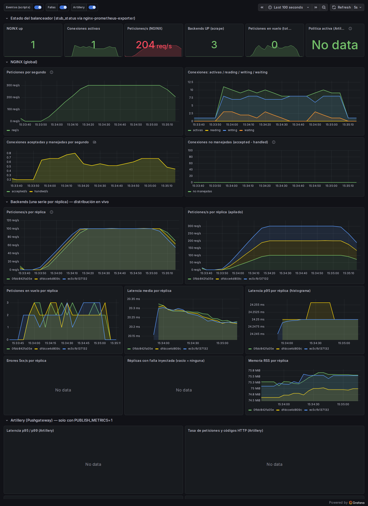
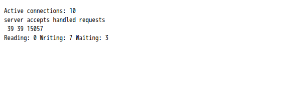
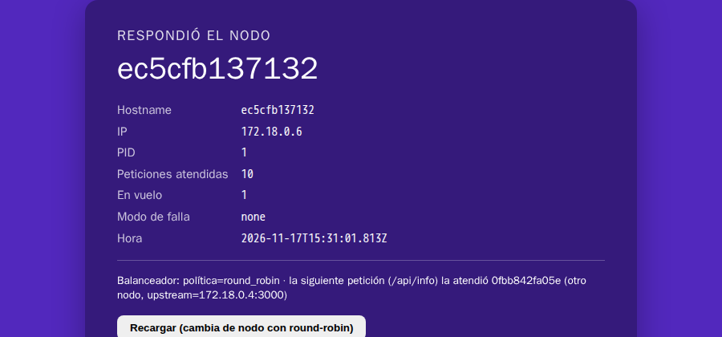
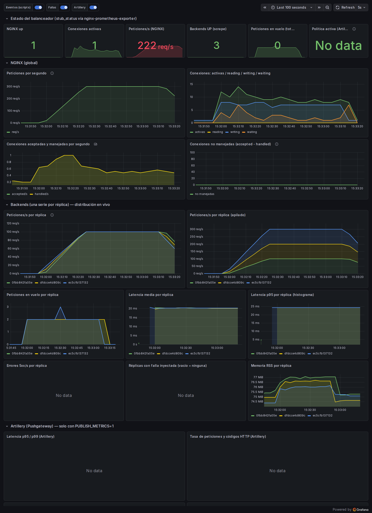
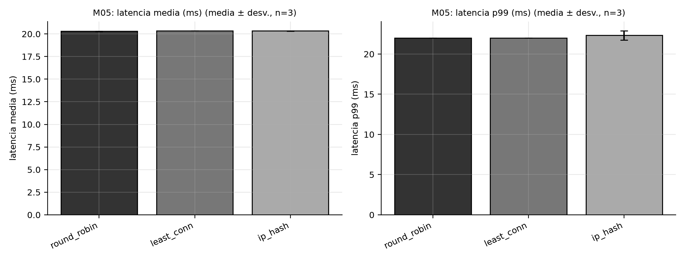
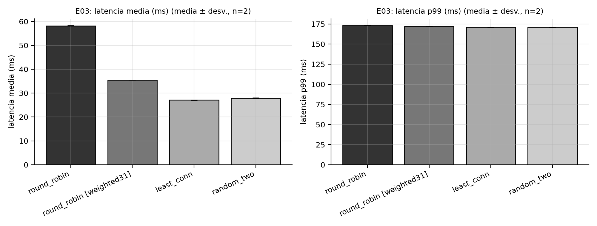
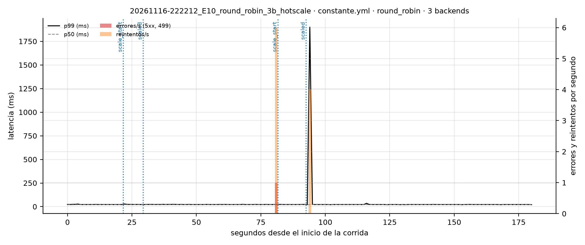
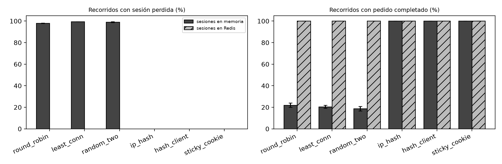
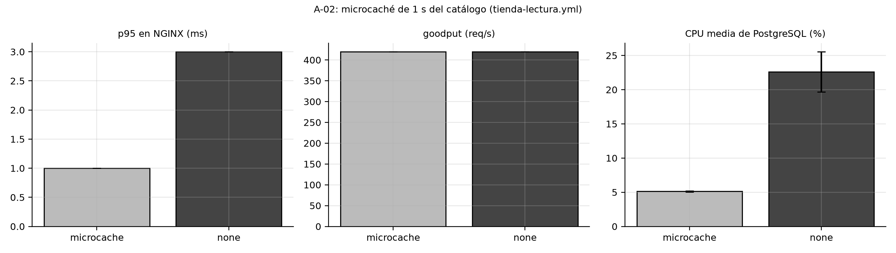

<!-- _class: lead -->
<!-- _paginate: false -->

# Balanceador de carga web con NGINX

### Clúster web contenedorizado, siete políticas de balanceo, una tienda con estado y pruebas de carga reproducibles con Artillery

**Fabio Jordan C. · Juan David Morales**
Servicios Telemáticos 2026-02 · Proyecto 2 · Grupo 3 (Lista 1)

---

## Contenido

<div class="cols">
<div>

1. Problema, objetivo y requisitos
2. Selección de la solución (matrices multicriterio)
3. Diseño e implementación
4. Metodología de pruebas
5. Pruebas mínimas del enunciado

</div>
<div>

6. Pruebas extendidas
7. Aplicación con estado: TelemaShop
8. Mejoras avanzadas (A-01 a A-06)
9. Hallazgos y conclusiones
10. Demostración en vivo

</div>
</div>

---

## El proyecto en cifras

<div class="kpis">
<div class="kpi"><b>25 / 25</b>requisitos del enunciado cumplidos con evidencia</div>
<div class="kpi"><b>195</b>corridas reales en 36 lotes, todas versionadas</div>
<div class="kpi"><b>7</b>políticas de balanceo intercambiables con un comando</div>
<div class="kpi"><b>11</b>hallazgos técnicos documentados</div>
<div class="kpi"><b>0</b>errores al retirar un backend bajo 300 req/s</div>
<div class="kpi"><b>1000</b>usuarios concurrentes sostenidos 60 s, 0 fallidos</div>
<div class="kpi"><b>171 → 23 ms</b>p95 con un backend lento al usar least_conn</div>
<div class="kpi"><b>×4,6</b>goodput al pasar de 1 a 5 réplicas</div>
<div class="kpi"><b>−77 %</b>CPU de PostgreSQL con microcaché de 1 s</div>
<div class="kpi"><b>100 %</b>compras completas con sesiones en Redis</div>
<div class="kpi"><b>3,5 s</b>failover del propio balanceador (keepalived)</div>
<div class="kpi"><b>6 / 6</b>mejoras avanzadas implementadas y medidas</div>
</div>

<div class="fuente">Fuente de todas las cifras: <code>results/ejemplos/</code> (GitHub Actions, 2 vCPU), analizadas con <code>analysis/</code> en contenedor.</div>

---

<!-- _class: divisor -->

# 1 · Problema, objetivo y requisitos

---

## Problema y objetivo

<div class="c64">
<div>

**Problema.** Una aplicación web servida por un solo servidor tiene:
- un **punto único de falla**: si cae, el servicio cae;
- un **techo de capacidad**: si la demanda lo supera, la latencia crece hasta fallar.

**Solución.** Un **balanceador de capa 7** (proxy inverso) reparte las peticiones entre N backends equivalentes: escalado horizontal y tolerancia a fallos.

**Objetivo.** Diseñar, implementar y evaluar experimentalmente un clúster web con NGINX, **todo en Docker Compose**, comparando algoritmos y midiendo desempeño y resiliencia con Artillery.

</div>
<div>

| Concepto del curso | Dónde se ve |
|---|---|
| Sin vs con balanceo | E-02: 1, 2, 3, 5 réplicas |
| Capa 4 vs capa 7 | `hash $http_x_client_id` solo es posible en L7 |
| Proxy inverso | el cliente solo ve al LB; backends sin puertos |
| RR, leastconn, source | `round_robin`, `least_conn`, `ip_hash` + 4 más |
| Alta disponibilidad | reintentos, detección pasiva, keepalived (A-04) |
| Pruebas de carga | Artillery: rampa, 1000 usuarios, quiebre |

</div>
</div>

---

## Requisitos del enunciado (1/2): balanceador y pruebas

| Requisito del catálogo (Proyecto 2) | Implementación | Evidencia |
|---|---|---|
| NGINX con `upstream` hacia **≥ 3 backends** | `backend_pool` con 3 réplicas, escalable a 7 sin recargar | `make smoke`: 10/10/10 |
| **round-robin, least_conn, ip_hash** implementados y comparados | un archivo por política, más 4 adicionales | M-05, E-03, matriz 4.2 |
| **stub_status** con métricas en tiempo real | servidor interno :8080, solo redes privadas | capturas de las 7 políticas |
| **Timeouts y reintentos** ante fallos | `proxy_*_timeout`, `proxy_next_upstream`, `max_fails` desde `.env` | M-03, E-07, E-08 |
| Escenarios Artillery con **ramp-up** progresivo | `rampa.yml`: 5 → 150 usuarios/s y meseta | M-05 |
| **Comparar rendimiento** entre algoritmos | 3 repeticiones, orden aleatorio, media ± desviación | M-05, comparación consolidada |
| Comportamiento ante **fallo de uno o más backends** | inyección automática de 7 modos de falla bajo carga | M-03, E-07, E-09 |

---

## Requisitos del enunciado (2/2): Docker y documentación

| Requisito del catálogo (Proyecto 2) | Implementación | Evidencia |
|---|---|---|
| `docker-compose.yml` con NGINX, ≥ 3 backends y Artillery | servicios `lb`, `backend` (replicas 3), `artillery` | `make up` |
| `nginx.conf` **montado como volumen**, no copiado | bind mounts `:ro`; imagen oficial sin Dockerfile | `docker inspect` |
| Red con nombre explícito; **backends sin puertos** | `lbnginx_frontend` y `lbnginx_backend` (`internal: true`) | `make ps` |
| `.env` con workers, puerto público y política | `NGINX_WORKER_PROCESSES`, `LB_PUBLIC_PORT`, `LB_POLICY` | `.env.example` |
| Prometheus + exporter (opcional, valorado) | exporter, Prometheus, Pushgateway y **Grafana aprovisionado** | capturas de Grafana |
| `docker-compose.override.yml` con **recarga en caliente** | watcher: `nginx -t && nginx -s reload` al cambiar un archivo | E-11: 0 errores |
| README con diagrama, comandos y resultados esperados | paso a paso, tablas de resultados y cumplimiento R-01…R-25 | `README.md` |

---

## Pruebas mínimas exigidas → resultado

| Prueba mínima del enunciado | Resultado medido | Veredicto |
|---|---|---|
| Cada algoritmo con capturas de `stub_status` | capturas reales de las **7 políticas** bajo carga; `accepts − handled = 0` | <span class="ok">cumple</span> |
| Eliminar un backend en caliente | **100 % de disponibilidad**, 0 errores, 3 reintentos (M-03) | <span class="ok">cumple</span> |
| 1000 usuarios concurrentes durante 60 s | meseta de **1000 activos 60 s**, 0 fallidos, p99 ≤ 76 ms (3/3 repeticiones) | <span class="ok">cumple</span> |
| Latencia media y p99: round-robin, least_conn, ip_hash | 20,30 / 20,35 / 20,33 ms · p99 22 ms: **no distinguibles** con backends iguales | <span class="ok">cumple</span> |
| Distribución real por backend desde los logs | log de NGINX = contadores de Artillery (**100 %**); RR 33,3 % por réplica; ip_hash 100 % a una | <span class="ok">cumple</span> |

<div class="fuente">Fuente: <code>results/ejemplos/lote-test-min-reps3-actions/</code>, <code>docs/capturas/</code>.</div>

---

<!-- _class: divisor -->

# 2 · Selección de la solución

Proceso estructurado con tres matrices multicriterio

---

## Proceso de evaluación y selección

<div class="cols">
<div>

**Método, igual en las tres matrices**
1. Alternativas relevantes del curso
2. Criterios con **peso** (suman 100)
3. **Cómo se mide** cada criterio
4. **Escala 1–5 con umbrales**, fijada antes de puntuar
5. Puntaje = Σ peso × puntuación / 5
6. **Sensibilidad**: ±5 en cada peso y umbrales de cambio
7. **Reflexión** sobre el resultado

</div>
<div>

| Matriz | Decide | Datos |
|---|---|---|
| **4.1** Tecnología | NGINX, HAProxy, Traefik, Apache, LVS | C1 y C5 **medidos**; resto con documentación oficial |
| **4.2** Algoritmo | 5 políticas | **todos los criterios medidos** en las pruebas |
| **4.3** Descubrimiento | estáticos, `resolve`, regenerar | criterios de diseño; revisada tras H-1 |

<div class="nota">La 4.2 se presenta después de las pruebas: se llena exclusivamente con sus resultados.</div>

</div>
</div>

---

## Matriz 4.1: tecnología de balanceo

| Criterio (peso) · cómo se mide | NGINX | HAProxy | Traefik | Apache | LVS |
|---|---|---|---|---|---|
| C1 Desempeño (20) · **medido**: p99 y CPU con la misma carga | 5 | 5 | 3 | 4 | 5† |
| C2 Algoritmos (15) · número en la documentación libre | 4 | 5 | 3 | 3 | 5 |
| C3 Detección de fallos (15) · activos, pasivos, reintentos | 3 | 5 | 5 | 5 | 1 |
| C4 Observabilidad (10) · métricas por servidor | 2 | 5 | 4 | 3 | 4 |
| C5 Facilidad (10) · **medido**: líneas del caso base funcionando | 4 | 4 | 3 | 3 | 2 |
| C6 Descubrimiento (10) · cómo entra una réplica nueva | 4 | 4 | 5 | 3 | 1 |
| C7 Madurez (10) · años y versiones recientes | 5 | 5 | 4 | 5 | 4 |
| C8 Funciones L7 (10) · cuántas de 6 trae la versión libre | 5 | 4 | 3 | 4 | 1 |
| **Puntaje /100** | **81** | **94** | **74** | **76** | **62** |

<div class="fuente">Escalas completas en el anexo y en <code>docs/decision-matrix.md</code> (p. ej. C2: 5 ≥ 8 algoritmos; C5: 4 = 11–20 líneas). † LVS no se puede medir en contenedores (IPVS vive en el kernel del host): 5 por diseño, declarado.</div>

---

## Matriz 4.1: mediciones, sensibilidad y reflexión

<div class="cols">
<div>

**Medido (A05B, 3 repeticiones, misma carga)**

| Alternativa | p99 | CPU LB | Líneas |
|---|---|---|---|
| NGINX 1.30 | 35,7 ms | 9,9 % | 20 |
| HAProxy 3.2 | 36,0 ms | 10,9 % | 18 |
| Apache 2.4 | 38,0 ms | 19,6 % | 23 |
| Traefik 3.7 | 41,2 ms | 28,1 % | 27 |

Con reutilización de conexiones **NGINX y HAProxy empatan**. En A-05, HAProxy perdía porque no reutilizaba conexiones.

</div>
<div>

**Sensibilidad.** ±5 en cualquier peso: el líder no cambia. Solo C6 ≥ 56 (Traefik) o C8 ≥ 46 (NGINX) lo cambian.

**Reflexión.**
- **La matriz no elige NGINX: HAProxy gana por 13 puntos** (checks activos y pasivos, más algoritmos y métricas por servidor).
- Al medir, la ventaja creció de 3 a 13: las primeras puntuaciones favorecían a NGINX sin evidencia.
- NGINX es **requisito del cliente**: la matriz valida la elección y expone su costo. Empata en desempeño, es la más completa en L7 y sus debilidades se mitigan en el diseño.
- Sin esa restricción, recomendaríamos HAProxy.

</div>
</div>

---

## Matriz 4.3: descubrimiento de backends

| Criterio (peso) · cómo se mide | Estáticos con nombre | DNS con `resolve` | Regenerar + reload |
|---|---|---|---|
| Escalar sin tocar la config (30) · pasos manuales para pasar de 3 a 5 | 1 | **5** | 3 |
| Pesos/backup por servidor (20) · ¿`weight` por réplica? | **5** | 2 | **5** |
| Simplicidad (20) · piezas que mantener | 3 | **4** | 2 |
| Robustez (30) · ¿arranca si un nombre no resuelve? | 3 | **4** | 2 |
| **Puntaje /100** | 56 | **78** | 58 |

- **Elegida: DNS con `resolve`** (NGINX ≥ 1.27.3): Docker resuelve `backend` a todas las réplicas y NGINX lo re-resuelve cada 5 s.
- **Revisión tras el hallazgo H-1:** con `resolve`, `hash … consistent` no mantiene la afinidad. Si la afinidad estable pesara **≥ 20/100**, convendría regenerar la configuración. Ningún requisito la exige: se mantiene `resolve`.

---

<!-- _class: divisor -->

# 3 · Diseño e implementación

---

## Arquitectura


<div class="small">

- **Dos redes con nombre:** `lbnginx_frontend` (solo el LB publica :8080) y `lbnginx_backend` (`internal: true`, sin salida).
- **Configuración 100 % externa:** volúmenes `:ro` + plantillas `envsubst`; cambiar de política = cambiar un archivo.
- **Backend instrumentado:** cabecera `X-Backend-Node`, inyección de fallos, `/metrics`; tienda con PostgreSQL y Redis.

</div>

---

## Configuración del balanceador

<div class="cols">
<div>

```nginx
resolver 127.0.0.11 valid=5s ipv6=off;

upstream backend_pool {
  zone backend_pool 128k;      # requerido por resolve
  include policies/${LB_POLICY}.conf;
  server backend:3000 resolve
         max_fails=3 fail_timeout=10s;
  keepalive 64;
}

location / {
  proxy_pass http://backend_pool;
  proxy_connect_timeout 2s;
  proxy_read_timeout    10s;
  proxy_next_upstream   error timeout
                        http_502 http_504;
  proxy_next_upstream_tries 3;
}
```

</div>
<div>

<div class="small">

**Parámetros en `.env`** (R-17): workers, puerto público, política, timeouts, `max_fails`, reintentos, réplicas y keepalive.

**Operación**
- `make policy P=least_conn`: cambia la política y valida con `nginx -t`
- `make scale N=5`: réplicas nuevas **sin recargar NGINX**
- `docker-compose.override.yml`: el watcher recarga al editar (R-19)
- `stub_status` en :8080, solo redes privadas (R-09)
- Log JSON con `$upstream_addr` y nodo por petición (R-25)

</div>

</div>
</div>

---

## Siete políticas de balanceo

| Política | Directiva | Cómo decide | Cuándo usarla |
|---|---|---|---|
| `round_robin` | (por defecto) | por turnos | backends iguales |
| `least_conn` | `least_conn;` | menos conexiones activas | backends con capacidad distinta |
| `random_two` | `random two least_conn;` | 2 al azar, el menos cargado | muchos balanceadores |
| `ip_hash` | `ip_hash;` | hash de la IP (**solo la /24**) | afinidad sin cabecera |
| `hash_remote_addr` | `hash $remote_addr;` | hash de la IP completa | afinidad por cliente |
| `hash_client` | `hash $http_x_client_id;` | hash **simple** de una cabecera | afinidad por usuario |
| `sticky_cookie` | `hash $lb_sticky_key;` | cookie `lbid` que emite el LB | sesiones locales en la réplica |

<div class="nota"><code>hash_client</code> usa hash simple y no <code>consistent</code>: con <code>resolve</code>, el hash consistente no mantiene la afinidad (hallazgo H-1).</div>

---

## Observabilidad

<div class="cols">
<div>

<div style="height:330px;overflow:hidden;border-radius:6px"></div>
<div class="fuente">Paneles de NGINX y por réplica con <code>least_conn</code> bajo carga.</div>

</div>
<div>

- **stub_status** → `nginx-prometheus-exporter` → Prometheus → **Grafana aprovisionado** desde el repositorio
- Paneles por réplica: req/s, en vuelo, latencia media y p95, errores 5xx, memoria
- Panel de tienda: sesiones perdidas, pedidos, pool de PostgreSQL
- Los scripts anotan eventos (fallas, escalados) en todas las gráficas



<div class="fuente">Capturas reales bajo carga (lote <code>capturas</code>, navegador sin interfaz).</div>

</div>
</div>

---

## Metodología de pruebas

<div class="cols">
<div>

**Ejecución reproducible**
- Todo en contenedores: Artillery, análisis y gráficas
- Un script por lote: `make test-min`, `test-algoritmos`, `test-ext`…
- **3 repeticiones**, orden aleatorio, 30 s de calentamiento descartados
- Cada corrida guarda `metadata.json` con la configuración **efectiva** de NGINX
- Ejecutado en **GitHub Actions** (2 vCPU) y verificado en la máquina del equipo

**Rigor**
- Diferencia ≤ desviación → **no distinguibles**
- Log de NGINX contrastado con Artillery (M-06)

</div>
<div>

**Escenarios Artillery**

| Escenario | Uso |
|---|---|
| `rampa.yml` | 5 → 150 usuarios/s y meseta |
| `p04-1000-usuarios.yml` | 1000 concurrentes (ley de Little) |
| `constante.yml` | fallas y operación en caliente |
| `quiebre.yml` | punto de quiebre |
| `soak.yml` | 15 min de resistencia |
| `tienda.yml` | compra completa |
| `ratelimit.yml` | cliente abusivo |

**Métricas:** latencia media/p95/p99, goodput, errores, Jain, CPU por contenedor, reintentos.

</div>
</div>

---

<!-- _class: divisor -->

# 4 · Pruebas mínimas del enunciado

---

## M-00 y M-01: reparto por nodo y stub_status por algoritmo

<div class="cols3">
<div>



</div>
<div>


</div>
<div>


</div>
</div>

<div class="small">

Tres visitas seguidas a `/nodo` con round-robin: cada una la atiende otro nodo, de otro color. **M-00:** 30 peticiones → **10 / 10 / 10**, 0 fallos.

| Política | Respuestas por backend (75 s a 100 usuarios/s) | `accepts − handled` |
|---|---|---|
| round_robin | 7 500 / 7 500 / 7 500 | 0 |
| least_conn · random_two · hash_client · sticky_cookie | ≈ 7 500 cada uno (7 326 a 7 599) | 0 |
| ip_hash · hash_remote_addr | 22 500 / 0 / 0 (una sola IP de origen) | 0 |

</div>

---

## M-02 y M-06: distribución real, vista en Grafana

<div class="small">round_robin: las tres réplicas reciben 100 req/s cada una (7 500 / 7 500 / 7 500)</div>
<div style="height:170px;overflow:hidden"></div>
<div class="small">ip_hash: una réplica recibe las 300 req/s (22 500 / 0 / 0): toda la carga sale de una sola IP</div>
<div style="height:170px;overflow:hidden"></div>

<div class="small">

**M-02:** 1000 peticiones secuenciales → 334 / 333 / 333, **índice de Jain 1,000**. **M-06:** el log de NGINX coincide al **100 %** con los contadores de Artillery.

</div>

---

## M-03: retirar un backend en caliente bajo 300 req/s


<div class="kpis">
<div class="kpi"><b>100 %</b>disponibilidad</div>
<div class="kpi"><b>0</b>errores visibles</div>
<div class="kpi"><b>3</b>reintentos de NGINX</div>
<div class="kpi"><b>22 ms</b>p99 estable</div>
</div>

<div class="fuente">t = 60 s: <code>docker rm -f</code> de una réplica · t = 120 s: se repone. Igual con least_conn.</div>

---

## M-04: 1000 usuarios concurrentes durante 60 s

<div class="c64">
<div>


</div>
<div>

**Diseño con la ley de Little**
1000 llegadas en 10 s × sesiones de ~70 s → meseta de **1000 activos**.

| Repetición | Creados / completados / fallidos | p99 |
|---|---|---|
| 1 | 1000 / 1000 / **0** | ≤ 76 ms |
| 2 | 1000 / 1000 / **0** | ≤ 76 ms |
| 3 | 1000 / 1000 / **0** | ≤ 76 ms |

<span class="ok">Meseta de 1000 usuarios activos durante 60 s en 3 de 3 repeticiones.</span>

</div>
</div>

---

## M-05: round-robin vs least_conn vs ip_hash

<div class="c64">
<div>



</div>
<div>

| Política | Media | p99 |
|---|---|---|
| round_robin | 20,30 ms | 22 ms |
| least_conn | 20,35 ms | 22 ms |
| ip_hash | 20,33 ms | 22 ms |

- Con backends iguales y peticiones cortas: **no distinguibles** (diferencia < desviación). Hipótesis confirmada.
- Pero `ip_hash` mandó **todo a un backend**: usa la /24 y la carga sale de una sola red.
- El algoritmo importa cuando los backends **no son iguales** (siguiente parte).

</div>
</div>

---

<!-- _class: divisor -->

# 5 · Pruebas extendidas

---

## E-03: un backend lento (150 ms, 0,25 CPU)

<div class="c64">
<div>



</div>
<div>

| Política | Media | p95 | Al lento |
|---|---|---|---|
| round_robin | 58,2 ms | **171 ms** | 25 % |
| RR con peso 3:1 | 35,5 ms | 171 ms | 10 % |
| **least_conn** | **27,1 ms** | **23 ms** | **4,5 %** |
| random_two | 27,9 ms | 25,5 ms | 4,9 % |

`least_conn` ve que el lento acumula conexiones y lo evita. **E-04:** si las peticiones solo esperan (sin CPU), no hay diferencia: un temporizador no forma cola.

</div>
</div>

---

## E-02 y E-13: escalabilidad y punto de quiebre

<div class="c64">
<div>


</div>
<div>

**E-02** (3 ms de CPU por petición):

| Réplicas | Goodput | Errores | p99 |
|---|---|---|---|
| 1 | 170 req/s | 81,5 % | 4 040 ms |
| 2 | 271 req/s | 62,6 % | 4 160 ms |
| 3 | 472 req/s | 41,0 % | 4 258 ms |
| 5 | **783 req/s** | **0 %** | 533 ms |
| 7 | 751 req/s | **0 %** | 345 ms |

Eficiencia 0,79–0,92: **×4,6 con 5 réplicas**; con 7 sobra capacidad.

**E-13** quiebre (error < 1 %, p99 < 1 s): **185 / 582 / 875 req/s** con 1 / 3 / 5 réplicas.

</div>
</div>

---

## E-07, E-08 y E-09: cómo falla un backend importa

<div class="cols">
<div>

| Modo de falla (E-07) | Errores en 30 s | p99 |
|---|---|---|
| stop / kill / crash | **0** | 22 ms |
| pause / hang | 9 (0,1 %) | **10 s** |
| responde 500 | **3 001 (33 %)** | 22 ms |

- Las caídas se resuelven solas: detección pasiva + reintento.
- **Un 500 no se reintenta** y la lentitud no se detecta (hallazgo H-4).
- **E-09:** sin ningún backend, página de mantenimiento; al volver, servicio en **0,84 s**.

</div>
<div>

**E-08: timeout × reintentos ante un backend colgado**

| `proxy_read_timeout` / reintentos | Errores | p99 |
|---|---|---|
| **3 s / sí** | **0** | **3 s** |
| 3 s / no | 201 | 3 s |
| 10 s / sí | 9 | 10 s |
| 10 s / no | 206 | 10 s |

Con 10 s el nodo colgado **nunca se marca caído** (199 reintentos). Regla: `max_fails × timeout < fail_timeout`.

</div>
</div>

---

## E-10, E-11, E-14, E-15: operación en caliente y resistencia

<div class="c64">
<div>



<div class="fuente">E-10: escalar 3 → 6 réplicas bajo carga y volver, sin recargar NGINX.</div>

</div>
<div>

| Prueba | Resultado |
|---|---|
| E-10 escalar 3 → 6 | **0 errores** |
| E-10 reducir 6 → 2 | 1 error en 54 000 |
| E-11 recargar la config | **0 errores** |
| E-14 pico ×16 de la tasa | **0 errores** |
| E-15 15 min continuos | 360 000 peticiones, **0 errores**, p99 21,8 ms al inicio y al final |
| E-12 keepalive on/off | no distinguibles (p99 22 ms) |

</div>
</div>

---

## E-05 y E-06: afinidad de sesión y su costo al escalar

<div class="cols">
<div>

| Política | Clientes fieles a un backend | Equidad (Jain) |
|---|---|---|
| round_robin / least_conn | ≈ 0 % | 1,00 |
| ip_hash | 100 % | **0,33** (todo a uno) |
| `hash_client` (hash simple) | **100 %** | **1,00** |
| `hash_client` consistent + `resolve` | 0 % (H-1) | 1,00 |

</div>
<div>

- La afinidad útil es por **usuario** (cabecera o cookie), no por IP: detrás de un NAT todos comparten IP.
- **E-06:** al pasar de 5 a 4 réplicas, el hash simple **remapea el 84 %** de los clientes (teoría: 80 %).
- El hash consistente reduciría eso, pero no funciona con `resolve` en NGINX libre (H-1).

</div>
</div>

---

## Comparación consolidada de todas las políticas


<div class="small">

1 = mejor del escenario. **least_conn** es la única política sin casillas débiles salvo afinidad; las de afinidad (`hash_client`, `sticky_cookie`) son las únicas que salvan la tienda con sesiones en memoria.

</div>

---

## Matriz 4.2: algoritmo recomendado con datos medidos

| Política | p99 homog. (20) | p95 un lento (25) | Jain (15) | Errores al caer (20) | Afinidad (10) | Simplicidad (10) | **/100** |
|---|---|---|---|---|---|---|---|
| **least_conn** | 5,0 (22 ms) | **5,0 (23 ms)** | 5,0 | 5,0 (0 %) | 1,0 | 5 | **92,0** |
| random_two | 5,0 (22 ms) | 4,5 (25,5 ms) | 5,0 | 5,0 (0 %) | 1,0 | 4 | 87,5 |
| hash_client | 5,0 (22 ms) | 1,0 (171 ms) | 5,0 | 5,0 (0 %) | **5,0** | 2 | 74,0 |
| round_robin | 4,9 (22,5 ms) | 1,0 (171 ms) | 5,0 | 5,0 (0 %) | 1,0 | 5 | 71,6 |
| ip_hash | 4,8 (23 ms) | 1,0 (113,5 ms) | 1,7 | 5,0 (0 %) | 5,0 | 5 | 69,2 |

- **Recomendación: `least_conn`.** Iguala a las demás con backends iguales y es la que mejor protege la latencia si uno se degrada.
- Estable con ±5 en cualquier peso. `hash_client` ganaría solo si la afinidad pesara **≥ 27/100**.

<div class="fuente">Normalización: menor es mejor 5·mejor/valor; Jain 5·J; errores 5·(1 − min(e, 5 %)/5 %); simplicidad por líneas de la política y requisitos al cliente.</div>

---

<!-- _class: divisor -->

# 6 · Aplicación con estado: TelemaShop

Recomendación del profesor: probar con funcionalidades y base de datos

---

## TelemaShop: una tienda real detrás del balanceador

<div class="c64">
<div>


</div>
<div>

- Catálogo de 2000 productos, búsqueda, login, carrito y **compra transaccional**
- **PostgreSQL 17** compartido por todas las réplicas
- Sesiones en **Redis** (compartidas) o en la **memoria** de cada réplica (`SESSION_STORE`)
- Panel de **diagnóstico del balanceo**: qué réplica atendió cada petición
- Política nueva **`sticky_cookie`**: el LB emite la cookie `lbid`
- Recorrido de compra en Artillery: portada → catálogo → búsqueda → detalle → login → 2 × carrito → compra

</div>
</div>

---

## E-16: ¿sobrevive la sesión al balanceo?

<div class="c64">
<div>



</div>
<div>

| Política | Memoria: sesión perdida | Memoria: compras OK | Redis: compras OK |
|---|---|---|---|
| round_robin | 97,9 % | 22,0 % | **100 %** |
| least_conn | 99,4 % | 20,5 % | **100 %** |
| random_two | 99,0 % | 18,7 % | **100 %** |
| ip_hash | 0 % | 100 % | **100 %** |
| hash_client | 0 % | 100 % | **100 %** |
| sticky_cookie | 0 % | 100 % | **100 %** |

**Con sesión local la afinidad es obligatoria; con Redis cualquier algoritmo sirve.**

</div>
</div>

---

## La base de datos compartida: el nuevo cuello de botella

<div class="cols">
<div>

**E-17:** de 1 a 5 réplicas, la CPU por réplica baja de 21 % a 9 %, pero **PostgreSQL sigue en ~23 %**: escalar backends no escala la base de datos.

**A-02 microcaché de 1 s en NGINX** (solo el catálogo público):



61,6 % de aciertos · CPU de PostgreSQL **22,6 → 5,1 % (−77 %)** · latencia media 1,24 → 0,28 ms.

</div>
<div>

**E-18 / E-19: caída de una dependencia (30 s)**

| | Antes (H-8) | Corregido |
|---|---|---|
| Réplicas sanas descartadas | 99,9 % | **0 %** |
| Catálogo con Redis caído | 27,8 % errores | **0 %** |
| Recuperación tras PostgreSQL | 6,3 s | **1,3 s** |

**Causa (H-8):** el 503 de la aplicación contaba como fallo en `proxy_next_upstream` y NGINX descartaba réplicas sanas. **Corrección:** quitar `http_503`; adoptado por defecto.

</div>
</div>

---

<!-- _class: divisor -->

# 7 · Mejoras avanzadas

A-01 a A-06: todas implementadas y medidas

---

## A-01 limitación de tasa y A-03 TLS + HTTP/2

<div class="cols">
<div>

**A-01:** 50 req/s por cliente con ráfaga de 100

| | Sin límite | Con límite |
|---|---|---|
| Cliente abusivo (~80 req/s) | 0 rechazos | **2 571 (35,9 %) 429** |
| Clientes normales | 0 rechazos | **0 rechazos** |
| p95 de los normales | 22 ms | 22 ms |
| Peticiones a los backends | 10 800 | **8 229 (−24 %)** |

El límite predice ≈ 2 600 rechazos; se midieron 2 571.

</div>
<div>

**A-03:** certificado generado en contenedor, `listen 443 ssl` + `http2 on`

- Negocia **TLS 1.3** con **ALPN h2** (`HTTP/2 200`)

| | HTTP | HTTPS |
|---|---|---|
| p95 de respuesta | 22 ms | 22 ms |
| Sesión completa (mediana) | 63,4 ms | 64,7 ms |
| CPU media del LB | 6,0 % | **8,1 %** |

**El costo de TLS es CPU, no latencia** (H-10: Artillery no mide el handshake en el tiempo de respuesta).

</div>
</div>

---

## A-04: alta disponibilidad del propio balanceador

<div class="cols">
<div>

**Dos NGINX + keepalived (VRRP) + IP flotante `172.31.250.100`**

- Cada keepalived comparte la red de su NGINX y comprueba `/lb-health` cada segundo
- Prueba: carga contra la VIP, `docker kill` del NGINX activo y vuelta a los 60 s
- Sonda propia cada 100 ms que registra qué NGINX respondió

<div class="nota">La VIP existe solo dentro de la red Docker; en producción estaría en la red física.</div>

</div>
<div>

| | Con preempción | `nopreempt` |
|---|---|---|
| Disponibilidad | 99,93 % | **99,95 %** |
| Failover | 3,71 s | **3,50 s** |
| Errores en el failover | 31 ± 8 | 28 ± 3 |
| Errores al volver el principal | **9 ± 2** | **0** |

- Sin keepalived, matar el único NGINX corta el servicio.
- **H-11:** la preempción corta las conexiones por segunda vez al volver el principal; `nopreempt` lo evita y quedó por defecto.

</div>
</div>

---

## A-05 comparativa de balanceadores y A-06 integración continua

<div class="cols">
<div>

**A-05 / A-05B:** misma carga y mismos backends

| Alternativa | p99 | CPU del LB |
|---|---|---|
| NGINX | 35,7 ms | 9,9 % |
| HAProxy | 36,0 ms | 10,9 % |
| Apache | 38,0 ms | 19,6 % |
| Traefik | 41,2 ms | 28,1 % |

Alimenta C1 y C5 de la matriz 4.1.

**A-02 microcaché** (parte 6): −77 % CPU de la base de datos.

</div>
<div>

**A-06: GitHub Actions en cada cambio**
- valida las 8 combinaciones de Compose y `nginx -t`
- shellcheck y finales de línea LF
- humo: 3 nodos, compra completa en la tienda
- sesiones con y sin afinidad, cambio de política, escalado en caliente
- TLS con HTTP/2 y 429 por cliente
- compila informe, diapositivas y diagrama

**Lotes de prueba bajo demanda** (`pruebas.yml`) y reanálisis de resultados (`analisis.yml`), con publicación opcional en Artillery Cloud.

</div>
</div>

---

<!-- _class: divisor -->

# 8 · Hallazgos y conclusiones

---

## Hallazgos: lo que no estaba en el enunciado

<div class="small">

| # | Hallazgo | Consecuencia |
|---|---|---|
| H‑1 | `hash … consistent` + `resolve` no da afinidad en NGINX 1.30.6 | `hash_client` con hash simple; remapeo del 84 % al escalar |
| H‑3 | `resolve` envía tráfico antes del healthcheck de Docker | lo mitigan detección pasiva y reintentos; solución completa: checks activos |
| H‑4 | Errores 500 y lentitud son invisibles para la detección pasiva | 33 % de errores con un backend que responde 500 |
| H‑5 | Con 2 vCPU el generador de carga es el cuello de botella | capacidad medida con costo de CPU |
| H‑6 | La afinidad no puede basarse en la cookie de la aplicación | el LB emite su propia cookie `lbid` |
| H‑8 | El 503 de una dependencia tumba réplicas sanas | sin `http_503`: recuperación 6,3 → 1,3 s |
| H‑9 | Cambios de `.env` a mitad de un lote no llegaban a los scripts | E-08 repetida; `metadata.json` guarda la config efectiva |
| H‑10 | El tiempo de respuesta de Artillery no incluye la conexión | TLS y failover medidos con la duración de la sesión |
| H‑11 | VRRP con preempción corta dos veces | `nopreempt` por defecto |

H-2 (backend que rechazaba conexiones) y H-7 (variables de HAProxy) fueron errores de implementación corregidos; detalle en `docs/hallazgos.md`.

</div>

---

## Conclusiones

<div class="cols">
<div>

**Sobre el balanceo**
- Aporta **disponibilidad** (0 errores al perder un backend) y **capacidad casi lineal** (×4,6 con 5 réplicas).
- Con backends iguales el algoritmo no importa; con **capacidad distinta**, `least_conn` (p95 171 → 23 ms).
- Los cuelgues cuestan el timeout: **3 s + reintentos** y `max_fails × timeout < fail_timeout`.
- Recomendación: **`least_conn`** (matriz 4.2, 92/100).

</div>
<div>

**Sobre un servicio real**
- Con estado, importa más **dónde vive la sesión** que el algoritmo: Redis + `least_conn`; si no puede salir de la réplica, `sticky_cookie`.
- La base de datos no escala con los backends; la **microcaché** sí la alivia.
- El propio balanceador deja de ser punto único de falla con **keepalived** (3,5 s).

**Limitación:** 2 vCPU compartidas entre generador y servicio.
**Trabajo futuro:** health checks activos, HA de PostgreSQL y Redis, TLS hasta los backends, Kubernetes.

</div>
</div>

---

## Demostración en vivo

<div class="cols">
<div>

1. **Despliegue:** `make up` y `make ps` → backends, PostgreSQL y Redis sin puertos al host
2. **Reparto:** `make smoke` y la página `/nodo` cambiando de nodo
3. **La tienda** en `localhost:8080`: buscar, login, carrito y compra; el panel muestra qué réplica atiende
4. **Sesiones:** `make sesiones S=memory` → «Sesión perdida»; `make policy P=sticky_cookie` → el carrito se conserva

</div>
<div>

5. **Grafana** con carga constante: distribución por réplica en vivo
6. **Afinidad:** `make policy P=ip_hash` → todo a un backend; `P=hash_client` → se reparte
7. **Falla:** `scripts/inject-fault.sh rm 1` → redistribución sin errores
8. **Escalado:** `make scale N=5` → réplicas nuevas **sin reiniciar NGINX**

<div class="nota">Guion completo y plan B en <code>docs/guion-demo.md</code>.</div>

</div>
</div>

---

<!-- _class: lead -->
<!-- _paginate: false -->

# ¿Preguntas?

**Repositorio:** github.com/FabioJDev/lb-nginx-telematicos · `make up && make smoke`

<div class="small">

Referencias: documentación de NGINX (`ngx_http_upstream_module`, `stub_status`), HAProxy 3.2, Traefik 3, Apache httpd 2.4, Artillery; Little (1961); Jain et al. (1984); Mitzenmacher (2001); Karger et al. (1997).

</div>

---

<!-- _class: divisor -->

# Anexos

Material de respaldo para preguntas

---

## Anexo A · Cumplimiento R-01 a R-25 (1/2)

<div class="small">

| ID | Requisito | Evidencia |
|---|---|---|
| R-01 | Todo en Docker/Compose, nada en el host | todos los servicios, Artillery y el análisis son contenedores |
| R-02 | README con instrucciones, diagramas y despliegue | `README.md` |
| R-03 | Informe IEEE ≤ 7 páginas | `docs/informe/informe.pdf` (6 páginas) |
| R-04 | Diapositivas en el repositorio | `slides/presentacion.pdf` (Marp, `make slides`) |
| R-05 | Repositorio con configuración y aprovisionamiento | este repositorio |
| R-06 | Presentación ≤ 20 min | `docs/guion-demo.md` |
| R-07 | NGINX con `upstream` hacia ≥ 3 backends | `http.conf.template`, `make smoke` |
| R-08 | round-robin, least_conn e ip_hash | `nginx/policies/`, M-05 |
| R-09 | `stub_status` | servidor interno :8080, `make status` |
| R-10 | Timeouts y reintentos | M-03, E-07, E-08 |
| R-11 | Rampa progresiva en Artillery | `artillery/scenarios/rampa.yml` |
| R-12 | Comparar algoritmos | `resumen_comparativo.csv`, figuras `algoritmos_*` |
| R-13 | Fallo de backends durante la prueba | figuras `resiliencia_*` |

</div>

---

## Anexo A · Cumplimiento R-01 a R-25 (2/2)

<div class="small">

| ID | Requisito | Evidencia |
|---|---|---|
| R-14 | Compose con NGINX, ≥ 3 backends y Artillery | `docker-compose.yml` |
| R-15 | `nginx.conf` como volumen, no en la imagen | bind mounts `:ro`; imagen oficial sin Dockerfile |
| R-16 | Red con nombre; backends sin puertos | `lbnginx_frontend`, `lbnginx_backend` (`internal`) |
| R-17 | `.env` para workers, puerto y política | `.env.example` |
| R-18 | Prometheus + exporter (valorado) | profile `monitoring` + Grafana, capturas |
| R-19 | Override con recarga en caliente | `docker-compose.override.yml`, watcher |
| R-20 | README con diagrama, comandos y resultados | secciones 1, 3 y 8 del README |
| R-21 | Cada algoritmo con capturas de `stub_status` | `docs/capturas/stub_status_<política>.png` |
| R-22 | Resiliencia al eliminar un backend | M-03: 100 % de disponibilidad |
| R-23 | 1000 usuarios concurrentes 60 s | M-04: meseta de 1000, 0 fallidos |
| R-24 | Latencia media y p99 por algoritmo | M-05, 3 repeticiones |
| R-25 | Distribución real desde los logs | M-06: log = Artillery al 100 % |

</div>

---

## Anexo B · Escalas de la matriz 4.1

<div class="small">

| Criterio | Escala 1–5 (fijada antes de puntuar) |
|---|---|
| C1 Desempeño | 5·(½·p99 mínimo/p99 + ½·CPU mínima/CPU), redondeado, mínimo 1 |
| C2 Algoritmos | 5 ≥ 8 · 4 = 5–7 · 3 = 3–4 · 2 = 2 · 1 = 1 |
| C3 Detección de fallos | 5 = activos + pasivos + reintentos · 4 = dos de tres · 3 = pasivos + reintentos · 2 = uno · 1 = ninguno |
| C4 Observabilidad | 5 = por servidor en Prometheus nativo · 4 = parcial o vía exportador · 3 = solo en página · 2 = solo globales |
| C5 Facilidad | líneas del caso base funcionando: 5 ≤ 10 · 4 = 11–20 · 3 = 21–30 · 2 = 31–40 · 1 > 40 |
| C6 Descubrimiento | 5 = API de Docker · 4 = re-resolución DNS · 3 = lista estática + recarga · 2 = reinicio · 1 = comandos |
| C7 Madurez | 5 = ≥ 15 años y versiones recientes · 4 = ≥ 10 años · 3 = 5–9 años · 2 = < 5 años |
| C8 Funciones L7 | de 6 (estáticos, caché, TLS, límite de tasa, reescritura, compresión): 5 = 6 · 4 = 5 · 3 = 4 · 2 = 2–3 |

**Evidencia por celda** (documentación oficial y mediciones) en `docs/decision-matrix.md` y `docs/decision-matrix-generada.md`.

</div>
