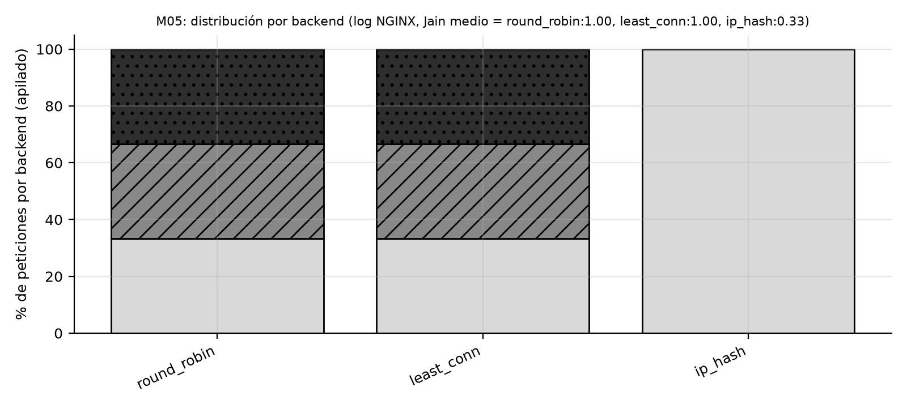
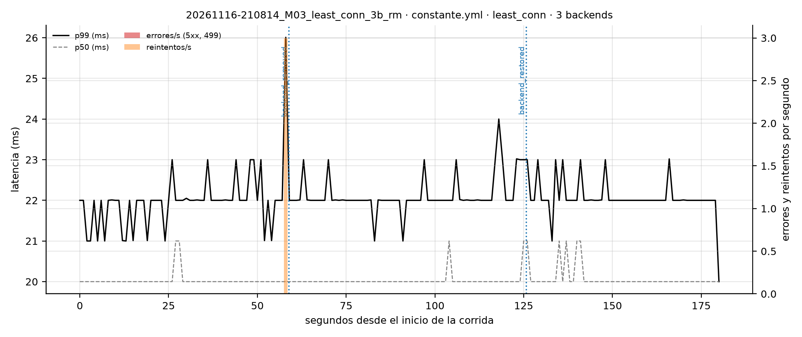

<!-- _class: lead -->
<!-- _paginate: false -->

# Balanceador de carga web con NGINX

### Clúster web contenedorizado, seis políticas de balanceo y pruebas de carga reproducibles con Artillery

**Fabio Jordan C. · Juan David Morales**
Servicios Telemáticos 2026-02 · Proyecto final 2 · Grupo 3 (Lista 1)

---

## Problema y objetivo

- Un único servidor web = **punto único de falla** + **techo de capacidad**: si cae, el servicio cae; si la demanda lo supera, la latencia crece hasta fallar.
- Un **balanceador L7** (proxy inverso) reparte las peticiones entre N backends equivalentes → escalado horizontal + tolerancia a fallos.

**Objetivo:** diseñar, implementar y evaluar experimentalmente un clúster web con balanceo NGINX, totalmente en Docker Compose, comparando algoritmos y caracterizando desempeño y resiliencia con Artillery.

---

## Conceptos del curso

| Concepto | En el proyecto |
|---|---|
| Sin balanceo vs con balanceo | E-01 (1 backend) vs 3, 5, 7 backends (E-02) |
| Balanceo L4 vs L7 | NGINX decide por cabeceras: `hash $http_x_client_id` es imposible en L4 |
| Proxy directo vs inverso | El cliente solo conoce al balanceador; backends sin puertos publicados |
| Round Robin, Leastconn, Source | `round_robin`, `least_conn`, `ip_hash` + `hash consistent`, `random two` |
| Alta disponibilidad y health checks | `max_fails`/`fail_timeout`, `proxy_next_upstream`, healthchecks Docker |
| Pruebas de carga con Artillery | usuarios concurrentes soportados y punto de quiebre (E-13) |

---

## Algoritmos de balanceo

| Política | Cómo decide | Advertencia |
|---|---|---|
| `round_robin` | turnos (ponderables) | ignora la carga real |
| `least_conn` | menos conexiones activas | ≈ RR con peticiones cortas |
| `ip_hash` | hash de la IP (**solo /24 en IPv4**) | toda una /24 → un backend |
| `hash_client` | hash **consistente** de `X-Client-Id` | el cliente debe enviar la cabecera |
| `random_two` | 2 al azar, el de menos conexiones | comparar con least_conn |

---

## Alternativas: matriz multicriterio 4.1

| Criterio (peso) · cómo se mide | NGINX | HAProxy | Traefik | Apache | LVS |
|---|---|---|---|---|---|
| C1 Desempeño (20) · throughput/p99 mismo escenario, `docker stats` | 5 | 5 | 4 | 3 | 5 |
| C2 Algoritmos (15) · conteo en docs versión libre | 4 | 5 | 3 | 4 | 5 |
| C3 Detección de fallos (15) · activos+reintentos=5, pasivos=3 | 3 | 5 | 4 | 4 | 1 |
| C4 Observabilidad (10) · métricas por backend sin pago | 2 | 5 | 5 | 3 | 2 |
| C5 Facilidad (10) · líneas de config + encuesta | 4 | 3 | 4 | 3 | 2 |
| C6 Docker/descubrimiento (10) · réplicas nuevas sin reinicio | 4 | 4 | 5 | 2 | 1 |
| C7 Madurez (10) · años, releases, docs | 5 | 4 | 4 | 4 | 3 |
| C8 Funciones L7 (10) · estáticos, caché, TLS, rate limit | 5 | 3 | 3 | 4 | 1 |
| **Puntaje /100** | **81** | **88** | **79** | **68** | **56** |

---

## Sensibilidad y reflexión

- ±5 en cualquier peso: **el ranking no cambia**. NGINX lideraría solo si C8 ≥ 24, C5 ≥ 34 o C7 ≥ 34; Traefik si C6 ≥ 38.
- **HAProxy supera a NGINX** en balanceo puro (checks activos, métricas por backend). Lo decimos.
- NGINX se selecciona porque:
  1. es la restricción del proyecto asignado (requisito del cliente);
  2. queda en el grupo líder (−7 puntos, ranking estable);
  3. funciones L7 completas en un solo componente;
  4. las debilidades se **mitigan en el diseño**: detección pasiva + reintentos (C3), exporter + logs JSON + `/metrics` por réplica (C4), `resolve` (C6).
- Matriz 4.3 (descubrimiento): DNS con `resolve` 78 > regenerar+reload 64 > estáticos 60.

---

## Arquitectura

Dos redes con nombre: <code>lbnginx_frontend</code> (publica :8080) y <code>lbnginx_backend</code> (<code>internal: true</code>). Config NGINX 100 % externa (volúmenes :ro + envsubst). Política = un archivo. Backend instrumentado (X-Backend-Node, fallos, /metrics).

---

## Cumplimiento de requisitos (resumen)

| Bloque | Requisitos | Evidencia |
|---|---|---|
| Infraestructura | R-07 upstream ≥ 3 · R-08 RR/least_conn/ip_hash · R-09 stub_status · R-10 timeouts/reintentos | `nginx/templates/http.conf.template`, `nginx/policies/` |
| Pruebas | R-11 rampa · R-12 comparación · R-13 fallos durante la prueba | `artillery/scenarios/`, `scripts/test-*.sh` |
| Docker | R-14 compose · R-15 nginx.conf volumen · R-16 redes/sin puertos · R-17 .env · R-18 Prometheus · R-19 override hot-reload · R-20 README | `docker-compose*.yml`, `monitoring/`, `README.md` |
| Mínimas | R-21 stub_status por algoritmo · R-22 resiliencia · R-23 1000 usuarios · R-24 media/p99 · R-25 logs | `results/`, `docs/figuras/` |

Más allá: 6 políticas, inyección de 7 modos de falla, escalado en caliente sin reload, Grafana aprovisionado, análisis automático, rate limiting, microcaché, comparativa HAProxy, CI.

---

## Demo en vivo (5 min)

1. `docker compose ps` → backends sin `0.0.0.0:`
2. Navegador `localhost:8080`: recargar → cambia nodo y color
3. Carga constante + Grafana: distribución por réplica en vivo
4. `make policy P=ip_hash` → todo a un backend (la /24) · `P=hash_client` → se reparte
5. `scripts/inject-fault.sh rm 1` → redistribución, error ≈ 0
6. `make scale N=5` → réplicas nuevas **sin reiniciar NGINX**

---

## Resultados: algoritmos (M-05)

Completar con results/resumen_comparativo.csv y significancia.txt (media ± desv., 3 repeticiones).

---

## Resultados: la trampa de ip_hash (E-05)

ip_hash: % al backend más cargado = ___; hash_client: Jain = ___, afinidad = ___ %.

---

## Resultados: resiliencia (M-03)

Disponibilidad ___ %, errores en 30 s ___, detección ___ s, recuperación ___ s.

---

## Resultados: escalabilidad y punto de quiebre (E-02 / E-13)

Eficiencia de escalado por N; carga máxima con error < 1 % y p99 < 1 s; cuello de botella (docker stats).

---

## Matriz 4.2 y conclusiones

- **Algoritmo recomendado (con datos):** ___ (docs/decision-matrix-generada.md)
- Con backends homogéneos RR ≈ least_conn (no distinguible); con heterogéneos least_conn/random_two protegen la cola.
- ip_hash no sirve detrás de NAT/una misma /24: afinidad L7 con `hash … consistent`.
- Resiliencia: reintentos pasivos bastan para caídas; los cuelgues dependen de `proxy_read_timeout`.
- Limitaciones: un solo host comparte CPU (generador + balanceador + backends).
- Trabajo futuro: HA del balanceador (keepalived/VRRP), TLS/HTTP2, Kubernetes.

---

<!-- _class: lead -->

# ¿Preguntas?

Repositorio: `lb-nginx-telematicos` · `make up && make smoke`
Referencias: NGINX docs (upstream, stub_status), Artillery docs, Little (1961), Jain (1984), Mitzenmacher (2001), Karger (1997)
